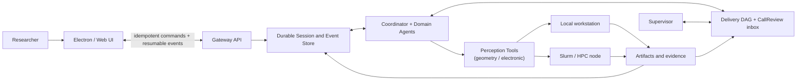

# Cloudra

**An agent runtime for small-molecule mechanism discovery: geometric & electronic perception, driven by an evidence-graph harness**

[](https://github.com/yyywaa/Cloudra-an-ai-agent-for-chemists/actions/workflows/ci.yml)
[](pyproject.toml)
[](pyproject.toml)

[中文](README_CN.md) · [Documentation](docs/README.md) · [DAG Orchestration](docs/DAG_ORCHESTRATION.md)

> Cloudra is research software under active development. It does not claim autonomous
> scientific validity or benchmark superiority. The verified scope and the explicitly
> un-claimed evidence are listed under [Evaluation status](#evaluation-status).

## The gap

Small-molecule mechanism elucidation is a long chain of interdependent calculations:
atom mapping, conformer sampling, transition-state search, frequencies, IRC,
endpoint optimization, thermochemistry. Today's LLM agents handle chemistry mostly
as *tool calls plus prose*, and they fail such studies in two characteristic ways:

1. **No reliable perception of molecules.** Left to itself, a model hand-writes
   coordinates, guesses at molecular orientations, and recites numbers from a
   drifting memory of earlier tool output. Geometry and electronic structure — the
   very objects a mechanism is made of — are exactly what a language model cannot
   see.
2. **Completion is declared, not derived.** Whether a mechanism has actually been
   established is judged by the model's own summary. A plausible paragraph stands
   in for an IRC-linked endpoint; nothing durable records which step rests on
   which evidence.

Cloudra attacks these two failure modes with two matching pillars: a **geometric
and electronic perception layer** that gives agents real eyes and hands on
molecules, and a **DAG-driven harness** that turns a mechanism hypothesis into an
auditable evidence graph whose completion is computed, not asserted.

This stack has carried a **complete ethylene ozonolysis mechanism study
end-to-end** (see [Demonstrated capability](#demonstrated-capability)).

## Pillar 1 — Geometric and electronic perception

Agents in Cloudra never type coordinates or transcribe energies from memory; they
*perceive* molecules through structured tools and quote the current tool output
verbatim:

- **Atom mapping** (`reaction_mapping`): reactant/product atom maps with explicit
  binding status and reaction-center watch pairs that follow the atoms through
  concrete 3D structures.
- **Bond-order-aware structure perception** (`internal_coordinates`): anomaly
  reports on bond lengths/angles, rotatable-bond classification, stereochemistry,
  and Z-matrix editing focused on the reaction center — the agent's "eyes and
  hands" instead of a GUI.
- **Orientation without hand-placing** (`conformer_search`): reacting atom pairs
  are locked by distance filters and the ensemble is sampled, so bimolecular
  approaches are found by force-field/xtb relaxation rather than guessed.
- **Electronic-structure perception** (`electronic_analysis`): atomic charges,
  Mayer bond orders (incipient/partial bonds), IBO Lewis pictures, and spin
  population with ⟨S²⟩ checks for open shells.
- **Reaction-path tooling**: TS interpolation guesses, scan preparation/parsing,
  strict IRC-direction verification, and log parsers that return structured
  energies, frequencies, and convergence status.

Hand-written coordinates are forbidden by policy across all roles — no exceptions
for "just adjusting a few atoms".

## Pillar 2 — DAG-driven harness

- **The mechanism graph as an auditable research object.** The investigated
  pathway is a persistent **delivery DAG** — the only persistent graph, not chat
  context. Nodes are intermediate *occurrences* — catalytic cycles and reversible
  steps stay acyclic by giving `Cat@entry` and `Cat@return` distinct nodes
  sharing one canonical species record. Every node and edge carries typed
  references (`artifact` / `compute_job` / `tool_result` / `species`) to
  immutable records; a bare file path or a prose claim is not evidence.
- **The graph states what evidence each element owes.** When proposing the
  mechanism, the Coordinator declares an ordered **stage contract** per element
  (occurrence: geometry/frequency/single_point; elementary step: ts_guess →
  ts_opt → frequency → short_irc → endpoints → direction/identity →
  thermochemistry). Stages bind strictly in order; finished delivery-relevant
  calls land in a CallReview inbox awaiting review. There is no second "todo"
  graph — no scheduling, no frontier.
- **Evidence-derived completion.** Stage status is
  `pending / supported / skipped / rejected`; element-level evidence levels
  (`structure_supported` → `saddle_supported` → `endpoint_supported` →
  `thermo_annotated`) are derived from stages by the deterministic harness.
  Advisory outputs (a TS guess, a scan) can only support the advisory ts_guess
  stage; `rejected` is not a disposal — it is an open gap still owed. A
  coverage contract evaluated over the graph decides whether the study may be
  delivered; only the human user can waive a gate.
- **Event-driven Supervisor.** In guided mode the Supervisor accepts or rejects
  the mechanism draft (compute stays gated until acceptance) and then reviews
  each delivery-relevant call from the inbox, binding evidence to stages
  (agree/disagree/skip). It cannot touch the mechanism graph structure, cannot
  promote evidence, and cannot mark the study complete.
- **A three-mode ablation boundary.** `standard` (no graph cost), `dag_record`
  (draft auto-accepted, Coordinator self-binds stages, no Supervisor), and
  `dag_guided` (Supervisor accepts the draft + reviews every delivery-relevant
  call) are per-session choices — the effect of graph bookkeeping and the
  effect of Supervisor control can be measured separately.

Underneath both pillars sits a durable session substrate that keeps hour- to
day-long experiments controllable across client, server, and process restarts:
every graph mutation, actor, rationale, and evidence reference is journaled;
artifacts are immutable; and prompt-assembly revisions are recorded with each
session.

### Research-management facilities

Beyond the two pillars, Cloudra ships the facilities a long-running study needs:

- **Domain sub-agents** (literature, small-molecule quantum chemistry, molecular
  dynamics, first-principles, experimental design, writing, environment), launched
  in parallel swarms and reporting back to the Coordinator.
- **Goal anchors and context compaction** (`/goal`, `/compact`): the objective
  survives compaction, and long sessions can be summarized mid-flight.
- **Reminders** for calculations, meetings, or ideas — they wake the agent on time.
- **An agent forum** (`agent_hub`) where parallel sub-agents share findings and
  call each other.
- **Approvals and questions**: destructive operations require user approval; agents
  can ask the user questions through in-UI panels.
- **Automatic recovery**: failed turns retry in place; after a process restart,
  messaging an interrupted agent reopens it without losing state.

## Demonstrated capability: D-A cycloaddition

Cloudra has run a **complete ethylene ozonolysis mechanism study**
end-to-end in guided mode:

- the Coordinator decomposed the objective, dispatched literature and domain
  sub-agents, and designed the candidate mechanism as a delivery DAG (with a
  stage contract per element);
- the Supervisor accepted the mechanism draft to unlock compute, then reviewed
  each delivery-relevant call — reaction mapping, conformer sampling, TS
  searches, optimization + frequency, short bidirectional IRC, endpoint
  optimizations, endpoint matching, and thermochemistry — binding evidence
  stage by stage and reacting to failures and inadequate evidence;
- the deterministic adapter validated every stage bind (order, call success,
  no submit-call evidence, parser checks);
- the final delivery was gated by the deterministic coverage report: claimed steps
  reached endpoint-supported status with IRC-linked, optimized endpoints, and the
  reported energetics carry documented level-of-theory provenance.

The full trace — every mutation, actor, rationale, and evidence reference — is
persisted in the session database and inspectable after the fact.

## How it works



Three planes stay separate: the **control plane** applies user commands, approvals,
and cancellation; the **research runtime** owns reasoning, delegation, the graph
state, and evidence; the **execution plane** enforces capabilities where work
actually occurs. Details and invariants are documented in
[`docs/DAG_ORCHESTRATION.md`](docs/DAG_ORCHESTRATION.md).

## Scientific scope

The current tools and skills cover workflows such as:

- small-molecule quantum chemistry: structure preparation, conformer search,
  TS/IRC workflows, Gaussian / ORCA input generation, asynchronous submission
  (Gaussian / VASP / ORCA / CP2K), state monitoring, and log parsing;
- electronic-structure analysis, atom mapping, format conversion, visualization,
  and image-to-structure workflows;
- literature retrieval, document conversion, evidence synthesis, and academic
  writing, with provider-native or external web search and cited sources;
- NMR and IR processing;
- domain planning for molecular dynamics, periodic first-principles modelling,
  experimental design, and scientific software environments.

Availability of a tool does not establish scientific correctness. Users remain
responsible for method selection, convergence, controls, uncertainty, and
interpretation. Cloudra is designed to preserve the evidence needed for that review.

## Evaluation status

Automated tests cover the graph store and mutation engine (acyclicity, occurrence
nodes, immutable evidence references, atomic batches, optimistic revisions,
permission boundaries), deterministic delivery completion, mode isolation, session
persistence and restart recovery, the perception tools (atom mapping, internal
coordinates, conformer search, TS/scan parsing, log parsing), prompt assembly,
command idempotency, artifact boundaries, node
routing, Slurm command construction, and backup/restore. CI runs the suite on CPython 3.11–3.13. The ozonolysis study above is a
demonstrated end-to-end run, not a benchmark.

The following evidence is still missing and is therefore **not claimed**:

- comparative scientific benchmark results against other agents or human baselines;
- systematic multi-reaction evaluation of mechanism-discovery success rates;
- submission and recovery trials on a real Slurm cluster;
- public-network deployment and long-duration operational reliability.

## Installation

Cloudra requires Python 3.11 or newer and an OpenAI-compatible model endpoint.

```bash
git clone https://github.com/yyywaa/Cloudra-an-ai-agent-for-chemists.git
cd Cloudra-an-ai-agent-for-chemists
python -m venv .venv
source .venv/bin/activate
pip install -e ".[all]"
cloudra config init
```

The one-line installers remain available for development checkouts:

```bash
./install.sh                 # Linux / macOS
# .\install.ps1              # Windows PowerShell
```

For cluster homes on NFS or Lustre, place `CLOUDRA_DATA_DIR` on a local filesystem
with reliable locking. SQLite WAL should not be used as a shared multi-host database.

### Web search configuration

`native_search` defaults to `auto`: the provider is detected from `base_url` +
`model` and its server-side search is enabled automatically. Override via
environment variables:

```bash
export CLOUDRA_COORDINATOR__NATIVE_SEARCH=auto        # off / auto / openai / openrouter / deepseek / gemini / custom
export CLOUDRA_COORDINATOR__NATIVE_SEARCH_PARAMS='{}' # custom injection params (relays)
```

When native search is off, the agent falls back to the external `web_search` tool
(Tavily / Brave / Bing / DuckDuckGo). When on, the external tool is removed to avoid
double searching. Note that external search is generally weaker than provider-native
search.

## Usage

The recommended frontend is the Electron/Web UI (Node.js >= 18 required):

```bash
./install.sh               # once: Python package + config
cloudra                    # install npm deps, build, start Electron
cloudra web --browser      # or serve the SPA in a plain browser
cloudra web --skip-build   # reuse the existing frontend/dist build
```

The web UI provides per-project workspaces, an AgentBar to switch among all
parallel agents, an Inspector with per-event detail, live YOLO/model settings,
approval/interaction/artifact control, and DAG panels.

Entry points:

```bash
cloudra                             # build and launch the Electron frontend
cloudra web --browser               # same runtime in the browser
```

Orchestration modes are per project: `standard` (default), `dag_record`, or
`dag_guided`, switchable from the project settings in the UI; the DAG panel
shows the mechanism graph and the review inbox.

Real calculations require the corresponding scientific software and licences.

## Reproducibility

If you use Cloudra in research, pin the commit hash and record the model, prompts,
tool revisions, software environment, and calculation inputs. The runtime records
prompt-assembly revisions and, for DAG sessions, a snapshot of the Supervisor
model, prompt revision, and graph-policy revision with each session; every graph
mutation carries its actor, rationale, and base revision in an append-only journal.

## Documentation

| Document | Contents |
| --- | --- |
| [`docs/DAG_ORCHESTRATION.md`](docs/DAG_ORCHESTRATION.md) | DAG-guided orchestration: mechanism graph + stage contracts, modes, permissions, evidence derivation |
| [`docs/PHASE8_NODE_REGISTRY.md`](docs/PHASE8_NODE_REGISTRY.md) | Multi-node profiles, workspace routing, worker leases, Slurm semantics |
| [`AGENTS.md`](AGENTS.md) | Repository map and development conventions for contributors |

## Repository layout

```text
cloudra/
├── core/                       agent/supervisor base classes, shared supervision
├── services/                   application service layer and FastAPI control plane
├── persistence/                SQLite store, artifacts, memory, paths
├── base/                       dataclasses and loader base types
├── infra/                      config, LLM transport, events, platform support
├── dag/                        DAG-driven harness (opt-in per session)
├── runtime/                    prompt assembly, workspace observer, compute job broker/monitor
├── runtime_v2/                 event-driven kernel (runs, commands, policies, bridges)
├── tools/, subagents/          perception tools, scientific capabilities, domain roles
├── skills/, prompts/           research methods and role policies
└── frontend/                   Electron + React control surface
```

## Development

```bash
uv run pytest -q tests/            # full test suite
uv run ruff check cloudra tests    # lint (line-length 120)
```

## Citing this work

Cloudra does not yet have an archival release. Until one exists, please cite the
repository together with the exact commit you used:

```bibtex
@misc{cloudra,
  title  = {Cloudra: An Agent Runtime for Small-Molecule Mechanism Discovery},
  author = {{Cloudra Developers}},
  year   = {2026},
  url    = {https://github.com/yyywaa/Cloudra-an-ai-agent-for-chemists},
  note   = {Commit-pinned research software; see repository README for evaluation status}
}
```

A citation file and benchmark report will be added only with a corresponding
evaluated release.

## License

MIT. See [`pyproject.toml`](pyproject.toml).
