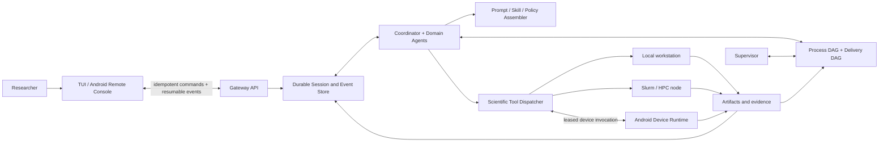

# Cloudra

**An evidence-graph-guided agent runtime for computational-chemistry mechanism studies**

[](https://github.com/yyywaa/Cloudra-an-ai-agent-for-chemists/actions/workflows/ci.yml)
[](pyproject.toml)
[](pyproject.toml)

[中文](README_CN.md) · [Documentation](docs/README.md) · [DAG Orchestration](docs/DAG_ORCHESTRATION.md) · [Android Guide](docs/ANDROID_USER_GUIDE.md)

> Cloudra is research software under active development. It does not claim autonomous
> scientific validity or benchmark superiority. The verified scope and the explicitly
> un-claimed evidence are listed under [Evaluation status](#evaluation-status).

## Overview

LLM agents can call chemistry tools, but a mechanism study is not finished when the
model says so — it is finished when the evidence says so. Cloudra is built around
that distinction. It runs long-horizon computational-chemistry research as durable,
multi-agent sessions, and it answers the two questions a mechanism study must answer
with **persistent, auditable graphs rather than chat history**:

- a **process DAG** records *what should be done next* — planned and completed work,
  its dependencies, blockers, and failures;
- a **delivery DAG** records *what has actually been established* — the investigated
  mechanism itself, whose intermediates and elementary steps carry typed references
  to immutable calculation records.

Whether the study is complete is **derived deterministically from referenced
evidence**, never from model claims. A transition state counts only when its
optimization, frequency, IRC, and endpoint evidence are all attached to the graph;
a plausible paragraph counts for nothing.

This substrate has carried a **complete ozonolysis mechanism study end-to-end**
(see [Demonstrated capability](#demonstrated-capability)).

## What is new

1. **The mechanism graph as an auditable research object.** The investigated
   pathway lives in a durable delivery DAG, not in model context. Nodes are
   intermediate *occurrences* — catalytic cycles and reversible steps stay acyclic
   by giving `Cat@entry` and `Cat@return` distinct nodes that share one canonical
   species record. Every node and edge carries typed references
   (`artifact` / `compute_job` / `tool_result` / `species`) to immutable records;
   a bare file path or a prose claim is not evidence.
2. **Evidence-derived completion, not model-declared completion.** Graph elements
   carry evidence levels (`proposed` → `structure_supported` → `saddle_supported`
   → `endpoint_supported` → `thermo_annotated`, plus `rejected`/`inconclusive`)
   that only the deterministic harness can promote, from the structured results
   actually referenced. Advisory outputs (a TS guess, a scan) cannot promote an
   edge. A coverage contract evaluated over the graph decides whether the study
   may be delivered; only the human user can waive a gate.
3. **Event-driven Supervisor orchestration.** In guided mode a Supervisor owns the
   process DAG: it schedules tool-level work bound to specific mechanism elements,
   reacts to new evidence and failures, arbitrates edge-removal requests, and
   audits before delivery. It cannot touch the mechanism graph, cannot promote
   evidence, and cannot mark the study complete.
4. **A three-mode ablation boundary.** `standard` (no graph cost), `dag_record`
   (deterministic graph bookkeeping, no Supervisor influence), and `dag_guided`
   (bookkeeping + Supervisor control) are per-session, immutable choices — so the
   effect of graph bookkeeping and the effect of Supervisor control can be measured
   separately.
5. **A durable session substrate underneath.** Idempotent commands, resumable event
   cursors, leased workers with auditable terminal states, immutable artifacts, and
   recorded prompt-assembly revisions keep hour- to day-long experiments
   controllable and reproducible across client, server, and process restarts.

## Demonstrated capability

Cloudra has run a **complete ethylene ozonolysis (C₂H₄ + O₃) mechanism study**
end-to-end in guided mode:

- the Coordinator decomposed the objective, dispatched literature and domain
  sub-agents, and designed the candidate mechanism as a delivery DAG;
- the Supervisor scheduled tool-level process work against each mechanism element —
  reaction mapping, conformer sampling, TS searches, optimization + frequency,
  short bidirectional IRC, endpoint optimizations, endpoint matching, and
  thermochemistry — reacting to each landed result and each failure;
- evidence from every calculation was bound to graph elements by the deterministic
  adapter, promoting intermediates and steps through the evidence levels; the
  strong multi-reference character of O₃ and method-sensitivity issues surfaced
  during the run were recorded as graph annotations rather than glossed over;
- the final delivery was gated by the deterministic coverage report: claimed steps
  reached endpoint-supported status with IRC-linked, optimized endpoints, and the
  reported energetics carry documented level-of-theory provenance.

The full trace — every mutation, actor, rationale, and evidence reference — is
persisted in the session database and inspectable after the fact.

## How it works



Three planes stay separate: the **control plane** applies user commands, approvals,
and cancellation; the **research runtime** owns reasoning, delegation, the graph
state, and evidence; the **execution plane** enforces capabilities where work
actually occurs. Details and invariants are documented in
[`docs/DAG_ORCHESTRATION.md`](docs/DAG_ORCHESTRATION.md).

## Scientific scope

The current tools and skills cover workflows such as:

- literature retrieval, document conversion, evidence synthesis, and academic writing;
- web search: provider-native search (OpenAI / DeepSeek / OpenRouter server-side
  `web_search`) or the external `web_search` tool, paired with `web_fetcher` for
  two-step evidence gathering, citations with source URLs;
- molecular structure preparation, conformer search, format conversion,
  visualization, and image-to-structure workflows;
- Gaussian / CP2K input generation, asynchronous calculation submission, state
  monitoring, and output parsing; TS guessing, scans, and IRC support tooling;
- NMR and IR processing;
- domain planning for molecular dynamics, periodic first-principles modelling,
  experimental design, and scientific software environments.

Availability of a tool does not establish scientific correctness. Users remain
responsible for method selection, convergence, controls, uncertainty, and
interpretation. Cloudra is designed to preserve the evidence needed for that review.

## Evaluation status

Automated tests cover the graph store and mutation engine (acyclicity, occurrence
nodes, immutable evidence references, atomic batches, optimistic revisions,
permission boundaries), deterministic delivery completion, mode isolation, session
persistence and restart recovery, prompt assembly, command idempotency, artifact
boundaries, device pairing, worker leases, node routing, Slurm command construction,
backup/restore, and sourceless Android packaging. CI runs the suite on CPython
3.11–3.13. The ozonolysis study above is a demonstrated end-to-end run, not a
benchmark.

The following evidence is still missing and is therefore **not claimed**:

- comparative scientific benchmark results against other agents or human baselines;
- end-to-end validation on a physical Android device and OEM background-policy matrix;
- submission and recovery trials on a real Slurm cluster;
- public-network deployment, production signing, and long-duration operational reliability.

## Installation

Cloudra requires Python 3.11 or newer and an OpenAI-compatible model endpoint.

```bash
git clone https://github.com/yyywaa/Cloudra-an-ai-agent-for-chemists.git
cd Cloudra-an-ai-agent-for-chemists
python -m venv .venv
source .venv/bin/activate
pip install -e ".[all]"
cloudra config init
```

The one-line installers remain available for development checkouts:

```bash
./install.sh                 # Linux / macOS
# .\install.ps1              # Windows PowerShell
```

For cluster homes on NFS or Lustre, place `CLOUDRA_DATA_DIR` on a local filesystem
with reliable locking. SQLite WAL should not be used as a shared multi-host database.

### Web search configuration

`native_search` defaults to `auto`: the provider is detected from `base_url` +
`model` and its server-side search is enabled automatically. Override via
environment variables:

```bash
export CLOUDRA_COORDINATOR__NATIVE_SEARCH=auto        # off / auto / openai / openrouter / deepseek / gemini / custom
export CLOUDRA_COORDINATOR__NATIVE_SEARCH_PARAMS='{}' # custom injection params (relays)
```

When native search is off, the agent falls back to the external `web_search` tool
(Tavily / Brave / Bing / DuckDuckGo). When on, the external tool is removed to avoid
double searching.

## Usage

```bash
cloudra                              # interactive TUI on Linux
cloudra run "TASK"                  # run or continue a research task
cloudra run "Elucidate the mechanism of ..." --orchestration-mode dag_guided
cloudra sessions                    # inspect durable Session states
cloudra history                     # list conversations
cloudra gui                         # experimental Flet GUI (currently untested; TUI is recommended)
cloudra-api                         # API server (localhost by default)
```

Orchestration modes are chosen per session and immutable afterwards:
`standard` (default), `dag_record`, or `dag_guided`. In the TUI, `/mode` selects
the mode and the DAG screens show and edit both graphs.

A minimal DAG-mode chemistry run:

```bash
cloudra run "Create a Gaussian input for benzene at B3LYP/6-31G(d) and save it under the active workspace"
cloudra run "Submit the benzene input and report the scheduler job identity"
cloudra run "After completion, parse the log and report energy, orbital gap, frequencies, and warnings with file references"
```

Real calculations require the corresponding scientific software and licences. For
Android remote control see [`docs/ANDROID_USER_GUIDE.md`](docs/ANDROID_USER_GUIDE.md);
a compact command and endpoint map is in
[`docs/CLI_API_REFERENCE.md`](docs/CLI_API_REFERENCE.md).

## Reproducibility

If you use Cloudra in research, pin the commit hash and record the model, prompts,
tool revisions, software environment, and calculation inputs. The runtime records
prompt-assembly revisions and, for DAG sessions, a snapshot of the Supervisor
model, prompt revision, and graph-policy revision with each session; every graph
mutation carries its actor, rationale, and base revision in an append-only journal.

## Documentation

| Document | Contents |
| --- | --- |
| [`docs/DAG_ORCHESTRATION.md`](docs/DAG_ORCHESTRATION.md) | DAG-guided orchestration: dual graphs, modes, permissions, evidence derivation |
| [`docs/CLI_API_REFERENCE.md`](docs/CLI_API_REFERENCE.md) | CLI commands and API endpoint map |
| [`docs/ANDROID_USER_GUIDE.md`](docs/ANDROID_USER_GUIDE.md) | API server, LAN setup, APK install, device runtime, troubleshooting |
| [`docs/PHASE8_NODE_REGISTRY.md`](docs/PHASE8_NODE_REGISTRY.md) | Multi-node profiles, workspace routing, worker leases, Slurm semantics |
| [`docs/PHASE8_OPERATIONS.md`](docs/PHASE8_OPERATIONS.md) | Backup/restore, device revocation, APK signing, database migration |
| [`AGENTS.md`](AGENTS.md) | Repository map and development conventions for contributors |

## Repository layout

```text
cloudra/
├── core/                       reasoning loop, agent roles, supervisor
├── services/                   application service layer and FastAPI control plane
├── persistence/                SQLite store, artifacts, memory, paths
├── base/                       dataclasses and loader base types
├── infra/                      config, LLM transport, events, platform support
├── dag/                        DAG-guided orchestration (opt-in per session)
├── runtime/                    session runners, workers, prompt assembly
├── device/                     Android capability registry and runtime
├── tools/, subagents/          explicit scientific capabilities and roles
├── skills/, prompts/           research methods and role policies
└── ui/, tui/                   human control surfaces
```

## Development

```bash
uv run pytest -q tests/            # full test suite
uv run ruff check cloudra tests    # lint (line-length 120)
```

## Citing this work

Cloudra does not yet have an archival release. Until one exists, please cite the
repository together with the exact commit you used:

```bibtex
@misc{cloudra,
  title  = {Cloudra: An Evidence-Graph-Guided Agent Runtime for Computational-Chemistry Mechanism Studies},
  author = {{Cloudra Developers}},
  year   = {2026},
  url    = {https://github.com/yyywaa/Cloudra-an-ai-agent-for-chemists},
  note   = {Commit-pinned research software; see repository README for evaluation status}
}
```

A citation file and benchmark report will be added only with a corresponding
evaluated release.

## License

MIT. See [`pyproject.toml`](pyproject.toml).
