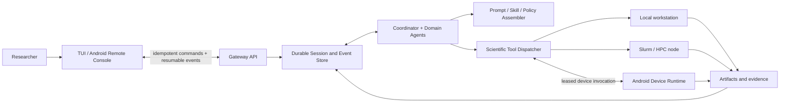

# Cloudra

### A durable agent runtime for computational-chemistry work

[中文](README_CN.md) · [Android guide](docs/ANDROID_USER_GUIDE.md) · [Architecture](docs/PHASE8_NODE_REGISTRY.md) · [Operations](docs/PHASE8_OPERATIONS.md)

Cloudra runs LLM-driven chemistry workflows that do not fit in a single chat turn. A literature search, a Gaussian job, an MD setup, or a Slurm submission can take hours or days, and the client or server may restart in the meantime. Cloudra keeps the Session state, tool calls, approvals, and artifacts in a durable store so the work survives disconnects and can be inspected later.

The terminal and Android clients are only control surfaces. The database is the source of truth for the experiment.

This is research software in active development. It does not claim autonomous scientific validity, benchmark superiority, or production readiness. The current repository is mostly the infrastructure needed to test those claims rigorously.

## Why this exists

Most agent demos are built around finishing a short task in one process. Scientific work breaks that assumption in a few ways:

- Calculations can outlast the model request, the client connection, or the server process.
- A plausible answer is not enough. You need a traceable input, artifact, log, or calculation state.
- Tools run across different trust and resource boundaries: a workstation, an HPC scheduler, and a personal device.
- Human clarification and approval are normal parts of the workflow, not exceptional UI interruptions.
- Changing prompts, tool schemas, files, or environments can silently break reproducibility.

Cloudra is built around these constraints instead of being layered on top of a generic chatbot.

## How it works

Cloudra treats each research objective as a durable Session. Conversation history, tool invocations, approvals, interactions, artifacts, and compute jobs are stored as records. Events wake workers and stream updates, but the database remains authoritative. Commands are idempotent and event cursors let clients reconnect without replaying an action that has already been applied. Worker ownership is represented by renewable leases with bounded retry and a terminal state.

A Coordinator breaks a research objective into subtasks and delegates them to explicit domain roles: literature, molecular quantum chemistry, periodic DFT, molecular dynamics, experiments, environment management, and writing. A Supervisor reviews trajectories and extracts reusable cases. Results stay linked to Session events, tool outputs, calculation files, and immutable artifacts rather than being collapsed into a final prose answer.

Before each model request, Cloudra reassembles the active role, project policy, memory, selected skills, and complete tool schemas. Revisions are recorded in diagnostics. Environment observations and file changes are kept separate from identity prompts and conversation history. That makes prompt drift visible and prevents an old experiment from being silently rewritten when the runtime changes.

Tools and sub-Agents are loaded from explicit registries, including sourceless Android packages. A validated node registry describes workspaces, scheduler type, and namespaced capabilities. Computation can run locally or through Slurm, and an Android client can register narrowly scoped device capabilities. The execution target keeps the final authority to reject unsafe writes, stale revisions, or missing permission.

Questions, approvals, cancellation, device waits, and interrupted execution are first-class Session states. High-risk operations pause with a concrete target, diff, or argument record. Android-local writes, document access, camera, and sharing require authorization at the device, so a server-side Agent cannot bypass the boundary by constructing a different tool call.

## System overview



The architecture separates three concerns:

1. The **control plane** applies user commands, approvals, and cancellation.
2. The **research runtime** owns reasoning, delegation, state, and evidence.
3. The **execution plane** enforces capabilities where work actually occurs.

This separation lets a phone disconnect without cancelling a calculation and lets a device go offline without disabling server-side scientific tools.

## Scientific scope

The current tools and skills cover workflows such as:

- literature retrieval, document conversion, evidence synthesis, and academic writing;
- molecular structure preparation, format conversion, visualization, and image-to-structure workflows;
- Gaussian input generation, asynchronous calculation submission, state monitoring, and output parsing;
- NMR and IR processing;
- domain planning for molecular dynamics, periodic first-principles modelling, experimental design, and scientific software environments.

Availability of a tool does not establish scientific correctness. Users remain responsible for method selection, convergence, controls, uncertainty, and interpretation. Cloudra is designed to preserve the evidence needed for that review.

## Evaluation status

The current codebase has automated coverage for explicit registries, prompt assembly, command idempotency, resumable event cursors, Session transitions, artifact boundaries, permissions, device pairing and revocation, worker leases, node routing, Slurm command construction, backup/restore, and sourceless Android packaging.

An ARM64 development APK is built at `build/apk/cloudra-android.apk`. Its ABI, SDK levels, `.pyc`-only runtime boundary, and APK v2 signature have been checked. The certificate is an Android Debug certificate and is not a release identity.

The following evidence is still missing and is therefore **not claimed**:

- comparative scientific benchmark results against other agents or human baselines;
- end-to-end validation on a physical Android device and OEM background-policy matrix;
- submission and recovery trials on a real Slurm cluster;
- public-network deployment, production signing, and long-duration operational reliability.

Android testing does not require a public server: a trusted LAN is sufficient. Public access should use HTTPS or a private network, never an exposed plaintext development endpoint. See the [Android guide](docs/ANDROID_USER_GUIDE.md) for the current procedure and limitations.

## Quick start

Cloudra requires Python 3.11 or newer and an OpenAI-compatible model endpoint.

```bash
git clone https://github.com/yyywaa/Cloudra-an-ai-agent-for-chemists.git
cd Cloudra-an-ai-agent-for-chemists
python -m venv .venv
source .venv/bin/activate
pip install -e ".[all]"
cloudra config init
cloudra run "Plan a reproducible conformational study for this molecule"
```

The one-line installers remain available for development checkouts:

```bash
./install.sh                 # Linux / macOS
# .\install.ps1              # Windows PowerShell
```

For cluster homes on NFS or Lustre, place `CLOUDRA_DATA_DIR` on a local filesystem with reliable locking. SQLite WAL should not be used as a shared multi-host database.

## Interfaces

```bash
cloudra                              # interactive TUI on Linux
cloudra run "TASK"                  # run or continue a research task
cloudra sessions                    # inspect durable Session states
cloudra history                     # list conversations
cloudra gui                         # experimental Flet GUI (currently untested; TUI is recommended)
cloudra-api                         # API server (localhost by default)
```

For Android remote control, start the API with an explicit Server Token and follow [`docs/ANDROID_USER_GUIDE.md`](docs/ANDROID_USER_GUIDE.md). Operational commands for backup, restore, device revocation, and APK signature auditing are documented in [`docs/PHASE8_OPERATIONS.md`](docs/PHASE8_OPERATIONS.md). A compact command and endpoint map is available in [`docs/CLI_API_REFERENCE.md`](docs/CLI_API_REFERENCE.md).

## Reproducible chemistry example

```bash
# Prepare an input while retaining the requested method in the Session trace.
cloudra run "Create a Gaussian input for benzene at B3LYP/6-31G(d) and save it under the active workspace"

# Submit asynchronously; the durable compute row survives client disconnects.
cloudra run "Submit the benzene input and report the scheduler job identity"

# Parse evidence instead of asking the model to infer an unobserved result.
cloudra run "After completion, parse the log and report energy, orbital gap, frequencies, and warnings with file references"
```

Real calculations require the corresponding scientific software and licences. Slurm nodes are declared through a validated registry; see [`deploy/node-registry.example.json`](deploy/node-registry.example.json).

## Repository map

```text
cloudra/
├── agent.py, react.py          reasoning and orchestration
├── runtime/                    Session runners, workers, prompt assembly
├── session_store.py            durable state transitions and leases
├── api.py, api_v1.py           local and remote control surfaces
├── nodes.py, slurm.py          capability routing and HPC execution
├── artifacts.py                immutable research outputs
├── device/                     Android capability registry and runtime
├── tools/, subagents/          explicit scientific capabilities and roles
├── skills/, prompts/           research methods and role policies
└── ui/, tui/                   human control surfaces
```

Architecture and operations documents live under [`docs/`](docs/README.md).

## Development and citation

```bash
pytest tests -q
ruff check cloudra tests
```

Some asynchronous SQLite tests can expose host-specific thread callback issues. Isolated test results and real runtime evidence should be reported separately rather than merging an incomplete run into a success claim.

Cloudra does not yet have an archival release or citation record. If you use it in research, pin the commit hash and record the model, prompts, tool revisions, software environment, and calculation inputs. A citation file and benchmark report will be added only with a corresponding evaluated release.

## License

MIT. See [`pyproject.toml`](pyproject.toml).
