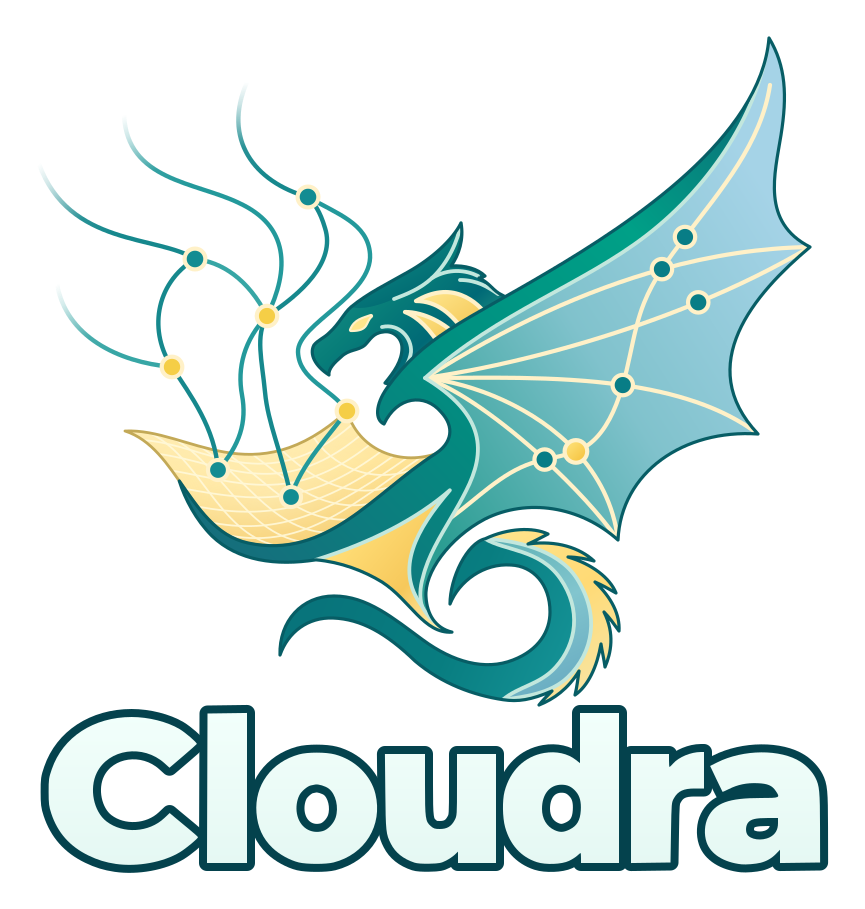

# Cloudra

<p align="center">
  
</p>

[](https://github.com/yyywaa/Cloudra-mechanism-agent/actions/workflows/ci.yml)
[](pyproject.toml)
[](LICENSE)

[中文](README_CN.md) · [Documentation](docs/README_EN.md) · [Paper & data](docs/RESEARCH_DATA.md) · [Contributing](CONTRIBUTING.md)

**A computational chemistry agent for exploring organic small-molecule reaction mechanisms.**

Cloudra connects language models, chemistry tools and quantum-chemical calculations to help researchers propose mechanisms, prepare structures, search for transition states and inspect computational evidence. Describe a research task in natural language, then follow the investigation, calculation jobs and output files in one workspace.

We want the reasoning to leave a checkable record: where structures came from, which methods were used, which pathways have supporting evidence and which questions remain open. Cloudra links species, reaction steps and calculation evidence through a mechanism graph. Conclusions in a report still need to be reviewed against the underlying results.

## What you can do

Start with a specific reaction pathway. Supply reactant and product structures, then specify the level of theory, solvent, available compute nodes and resource scope in your project. For example:

> Investigate a pathway between the reactants and products in this workspace. First check the structures, atom correspondence, charge and spin. Use my specified method to search for a transition state, then examine its connectivity with frequency analysis and bidirectional IRC calculations. Report the computational evidence, result files and unresolved questions. Ask before changing the method or expanding the calculation scope.

This illustrates how to write a task; it is not a completed calculation case study. Running it requires a configured model and quantum-chemistry software, and consumes model calls and compute resources.

During a study, you can inspect agent discussions and tool results, the calculation queue and native logs. Graph modes also expose species, reaction steps and their evidence status. Follow the file references in the final report to inspect structures, frequencies and pathways; a normally terminated job does not establish a complete mechanism.

## Install and start

You need **Linux or macOS, Python ≥ 3.11, Node.js ≥ 22**, and access to a language-model service. Install and configure the quantum-chemistry software needed for your study separately, such as ORCA, Gaussian, xTB or CREST.

```bash
git clone https://github.com/yyywaa/Cloudra-mechanism-agent.git
cd Cloudra-mechanism-agent
./install.sh

# If you selected the default .venv during installation, activate it here
source .venv/bin/activate

# Install dependencies for the default JavaScript tool runtime
npm ci --prefix cloudra/runtime_v2/js_host --ignore-scripts --no-audit --no-fund

# Build the frontend and start the web interface
cloudra
```

The installer guides you through configuration initialization. Open the address printed at startup; the default is `127.0.0.1:8000`.

1. Configure the coordinator and follower models in Global Settings. You can use an OpenAI-compatible endpoint or select ChatGPT / Codex account login.
2. Configure the software and compute nodes needed for your study. See the [deployment guides](docs/README_EN.md#deployment-and-configuration) for remote computation.
3. Create a project, select its working directory, add structures or existing calculation files, and describe the task and calculation scope.

See [Configuration](docs/CONFIGURATION.md) for model login, web search, common commands and remote access.

## Three working modes

Choose a mode in project settings:

| Mode | How it organizes the work |
| --- | --- |
| `standard` (default) | Research with chemistry tools, without requiring evidence to be organized through the delivery graph. |
| `dag_record` | Record species, reaction steps and evidence in a mechanism graph; the executing agent binds results. |
| `dag_guided` | Add an independent Supervisor to review mechanism drafts and submitted claims. |

A mode does not replace scientific validation. See the [DAG guide](docs/DAG_ORCHESTRATION.md) for graph delivery and the [TS guide](docs/TS_PROCESS_SOP.md) for transition-state workflows and evidence requirements.

## Paper, data and reproduction

**Cloudra: Geometric Reasoning and Scientific Validation for Autonomous Reaction Mechanism Exploration** is being prepared for arXiv. The repository contains the [English and Chinese manuscript sources and SI](paper/overleaf/README.md); a public paper link will be added after release.

The [research data and reproduction guide](docs/RESEARCH_DATA.md) separates reproducing paper figures, inspecting original agent runs, reviewing Gold reference calculations and rerunning the benchmark. The formal bank contains 50 tasks; P2 comprises four configurations and 200 retained runs. Check the [P2 delivery page](docs/benchmarks/P2_DELIVERY.md) for the full archive's upload status.

## Contribute and cite

Issues, experience reports and improvements are welcome. For calculation problems, include software versions, the task description, input files and relevant logs so we can investigate the cause. See [CONTRIBUTING.md](CONTRIBUTING.md) for development conventions and [Architecture](docs/ARCHITECTURE.md) for the system structure.

If you use Cloudra in research, please cite the manuscript and record the software commit used:

> Chengyi Yang, Qianxin Zhou, and Yang Li. *Cloudra: Geometric Reasoning and Scientific Validation for Autonomous Reaction Mechanism Exploration*. Working draft, 31 October 2026.

Qianxin Zhou and Yang Li contributed equally as co-second authors. [BibTeX](CITATION.bib) · [GitHub citation metadata](CITATION.cff). The arXiv identifier will be added after publication.

## License

Cloudra is licensed under [AGPL-3.0-or-later](LICENSE), without warranty as specified in the license. Skills in `cloudra/skills/` that declare MIT use the MIT license. Bundled third-party components retain their own licenses; see [third-party attribution](docs/licenses/README.md). Contributions use the Developer Certificate of Origin; sign off commits with `git commit -s`.
