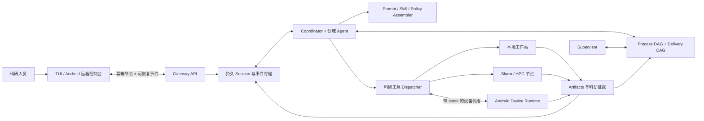

# Cloudra

**证据图驱动的计算化学机理研究 Agent Runtime**

[](https://github.com/yyywaa/Cloudra-an-ai-agent-for-chemists/actions/workflows/ci.yml)
[](pyproject.toml)
[](pyproject.toml)

[English](README.md) · [文档索引](docs/README.md) · [DAG 编排](docs/DAG_ORCHESTRATION.md) · [Android 使用教程](docs/ANDROID_USER_GUIDE.md)

> Cloudra 仍在开发。目前不声称系统能自主保证科研正确或跑赢 benchmark。已验证
> 范围与明确不作声明的证据见[验证现状](#验证现状)。

## 概述

LLM Agent 会调化学工具，但机理研究不是模型说做完了就做完了——**证据说了算**。
Cloudra 围绕这个区别构建：它把长周期的计算化学研究跑成持久的多 Agent 会话，
并且用**持久、可审计的图**而不是聊天记录来回答机理研究必须回答的两个问题：

- **process DAG** 记录*下一步该做什么*——计划与已完成的工作、依赖、阻塞和失败；
- **delivery DAG（机理图）** 记录*已经确立了什么*——被研究的机理本身，每个
  中间体和基元步都携带指向不可变计算记录的类型化引用。

研究是否完成由**引用证据确定性派生**，不由模型声明。一个过渡态只有在优化、
频率、IRC 和端点证据全部挂到图上才算数；一段读起来合理的文字不算数。

这套底座已经**完整跑通了一整个乙烯臭氧化机理寻找**（见[已验证的端到端能力](#已验证的端到端能力)）。

## 新意所在

1. **机理图成为可审计的研究对象。** 被研究的路径生活在持久的 delivery DAG 里，
   而不是模型上下文里。节点是中间体的 *occurrence*——催化循环和可逆步通过让
   `Cat@entry` 与 `Cat@return` 成为共享同一份 canonical species 记录的不同节点
   来保持图无环。每个节点和边携带类型化引用（`artifact` / `compute_job` /
   `tool_result` / `species`），指向不可变记录；裸文件路径和散文声明都不是证据。
2. **完成度由证据派生，不由模型宣布。** 图元素携带证据级别（`proposed` →
   `structure_supported` → `saddle_supported` → `endpoint_supported` →
   `thermo_annotated`，另有 `rejected` / `inconclusive`），只有确定性 harness 能
   根据实际引用的结构化结果提升级别。探索性输出（TS 初猜、扫描）不能提升一条边。
   覆盖契约（coverage contract）在图上评估研究能否交付；只有用户本人能豁免 gate。
3. **事件驱动的 Supervisor 编排。** 引导模式下 Supervisor 拥有 process DAG：
   它把工具级工作绑定到具体机理图元素上排产，对新证据和计算失败做出反应，
   裁决删边申请，交付前审计。它不能碰机理图、不能提升证据级别、不能宣布研究
   完成。
4. **三模式消融边界。** `standard`（零图成本）、`dag_record`（只有确定性图
   簿记，无 Supervisor 影响）、`dag_guided`（簿记 + Supervisor 控制）是按会话
   选择、选定后不可变的模式——图簿记本身的效果和 Supervisor 控制的效果可以
   分开测量。
5. **底层是持久会话基座。** 幂等命令、可恢复事件游标、带可审计终态的 lease
   worker、不可变 artifact、记录在案的 prompt 组装 revision，让以小时到天计的
   实验跨过客户端、服务器和进程重启仍然可控、可复现。

## 已验证的端到端能力

Cloudra 已在引导模式下**完整跑通乙烯臭氧化（C₂H₄ + O₃）机理研究**：

- Coordinator 拆解目标，派出文献与领域子 Agent，并把候选机理设计为 delivery DAG；
- Supervisor 针对每个机理图元素排产工具级工作——反应映射、构象采样、TS 搜索、
  优化+频率、短双向 IRC、端点优化、端点匹配、热化学——对每一个落地的结果和
  每一次失败做出反应；
- 确定性适配器把每个计算的证据绑定到图元素上，推动中间体和基元步逐级提升
  证据级别；运行中暴露的 O₃ 强多参考特征和方法敏感性问题被记为图注解，
  而不是被一笔带过；
- 最终交付由确定性覆盖报告把关：声称的基元步达到 endpoint-supported，端点
  经 IRC 链接并完成优化，报告的能量带有明确的级别（level-of-theory）来源说明。

完整轨迹——每一次图变更、操作者、理由和证据引用——都持久化在会话数据库里，
事后可审计。

## 工作方式



三个平面保持分离：控制面负责用户命令、审批和取消；科研 runtime 负责推理、
委派、图状态和证据；执行面在真正干活的地方强制能力边界。细节与不变量见
[`docs/DAG_ORCHESTRATION.md`](docs/DAG_ORCHESTRATION.md)。

## 覆盖范围

当前工具与技能生态覆盖：

- 文献检索、文档转换、证据整合与学术写作；
- 联网搜索：模型原生搜索（OpenAI / DeepSeek / OpenRouter 等服务商侧 `web_search`）
  或外部 `web_search` 工具，配合 `web_fetcher` 两段式取证，引用带来源 URL；
- 分子结构准备、构象搜索、格式转换、可视化和图像到结构工作流；
- Gaussian / CP2K 输入生成、异步计算提交、状态监控和输出解析；TS 初猜、扫描
  与 IRC 支持工具；
- NMR 与 IR 数据处理；
- 分子动力学、周期第一性原理、实验设计和科研软件环境的领域规划。

"有工具"不等于"结论正确"。方法选择、收敛性、对照、不确定性与结果解释仍需研究者
负责。Cloudra 的目标是保留完成这些审阅所需的证据。

## 验证现状

自动化测试覆盖图存储与变更引擎（无环性、occurrence 节点、不可变证据引用、
原子批次、乐观 revision、分权边界）、确定性交付完成度、模式隔离、会话持久化与
重启恢复、prompt 组装、命令幂等、artifact 边界、设备配对、worker lease、节点
路由、Slurm 命令构造、备份恢复和无源码 Android 打包。CI 在 CPython 3.11–3.13
上运行全套测试。上述臭氧化研究是一次已演示的端到端运行，不是 benchmark。

以下证据仍然缺失，因此项目**不作对应声明**：

- 与其他 Agent 或人类基线对比的科研 benchmark 结果；
- Android 真机、厂商后台限制和原生权限矩阵的端到端验收；
- 真实 Slurm 集群上的提交、取消和恢复实验；
- 公网部署、生产签名和长周期运维可靠性。

## 安装

Cloudra 需要 Python 3.11 或更新版本，以及 OpenAI 兼容的模型服务。

```bash
git clone https://github.com/yyywaa/Cloudra-an-ai-agent-for-chemists.git
cd Cloudra-an-ai-agent-for-chemists
python -m venv .venv
source .venv/bin/activate
pip install -e ".[all]"
cloudra config init
```

开发 checkout 也可以用一键安装脚本：

```bash
./install.sh                 # Linux / macOS
# .\install.ps1              # Windows PowerShell
```

如果集群 home 位于 NFS/Lustre，应把 `CLOUDRA_DATA_DIR` 放到具有可靠文件锁的本地
磁盘；SQLite WAL 不能充当多主机共享数据库。

### 联网搜索配置

默认 `native_search=auto`：按 `base_url` + `model` 自动识别并启用服务商侧原生
搜索。需要时可用环境变量覆盖：

```bash
export CLOUDRA_COORDINATOR__NATIVE_SEARCH=auto        # off / auto / openai / openrouter / deepseek / gemini / custom
export CLOUDRA_COORDINATOR__NATIVE_SEARCH_PARAMS='{}' # 自定义注入参数（自建中转站用）
```

未启用原生搜索时，Agent 使用外部 `web_search` 工具（Tavily / Brave / Bing /
DuckDuckGo）作为免 key 兜底。启用后外部工具会被剔除，避免双重搜索。

## 使用入口

```bash
cloudra                              # Linux 交互式 TUI
cloudra run "TASK"                  # 运行或继续研究任务
cloudra run "阐明……的反应机理" --orchestration-mode dag_guided
cloudra sessions                    # 检查持久 Session 状态
cloudra history                     # 查看 Conversation
cloudra gui                         # 实验性 Flet GUI（未充分测试，推荐 TUI）
cloudra-api                         # API Server，默认只监听本机
```

编排模式按会话选择、选定后不可变：`standard`（默认）、`dag_record`、
`dag_guided`。TUI 里用 `/mode` 选择模式，DAG 屏幕可以查看并编辑两张图。

一个最小的 DAG 模式计算流程：

```bash
cloudra run "在当前工作区生成苯的 B3LYP/6-31G(d) Gaussian 输入，并记录方法设置"
cloudra run "异步提交苯的输入文件，并报告 scheduler job identity"
cloudra run "计算结束后解析日志，给出能量、轨道能隙、频率、警告和文件引用"
```

真实计算需要对应科研软件及许可证。Android 远程控制见
[`docs/ANDROID_USER_GUIDE.md`](docs/ANDROID_USER_GUIDE.md)，命令与接口速查见
[`docs/CLI_API_REFERENCE.md`](docs/CLI_API_REFERENCE.md)。

## 可复现性

用于科研时，请固定 commit hash，并记录模型、prompt、工具 revision、软件环境和
计算输入。runtime 会记录每次 prompt 组装的 revision；DAG 会话还会随 session 保存
Supervisor 模型、prompt revision 与图策略 revision 的快照；每一次图变更的操作者、
理由和 base revision 都留在 append-only 变更日志里。

## 文档

| 文档 | 内容 |
| --- | --- |
| [`docs/DAG_ORCHESTRATION.md`](docs/DAG_ORCHESTRATION.md) | DAG 引导编排：双图模型、模式、分权、证据派生 |
| [`docs/CLI_API_REFERENCE.md`](docs/CLI_API_REFERENCE.md) | CLI 命令与 API 端点速查 |
| [`docs/ANDROID_USER_GUIDE.md`](docs/ANDROID_USER_GUIDE.md) | API Server、局域网配置、APK 安装、设备端 runtime、故障排查 |
| [`docs/PHASE8_NODE_REGISTRY.md`](docs/PHASE8_NODE_REGISTRY.md) | 多节点 profile、工作区路由、worker lease、Slurm 语义 |
| [`docs/PHASE8_OPERATIONS.md`](docs/PHASE8_OPERATIONS.md) | 备份恢复、设备撤销、APK 签名、数据库迁移 |
| [`AGENTS.md`](AGENTS.md) | 仓库地图与开发约定（面向贡献者） |

## 仓库结构

```text
cloudra/
├── core/                       推理循环、Agent 角色、Supervisor
├── services/                   应用服务层与 FastAPI 控制面
├── persistence/                SQLite 持久化、artifact、记忆、路径
├── base/                       数据类与加载器基类
├── infra/                      配置、LLM 传输、事件、平台支撑
├── dag/                        DAG 引导编排（可选，按会话开启）
├── runtime/                    Session runner、worker 与 prompt 组装
├── device/                     Android 能力注册与 runtime
├── tools/, subagents/          显式科研能力与领域角色
├── skills/, prompts/           科研方法与角色策略
└── ui/, tui/                   人类控制界面
```

## 开发

```bash
uv run pytest -q tests/            # 全套测试
uv run ruff check cloudra tests    # lint（line-length 120）
```

## 引用

Cloudra 目前没有归档 release。在归档版本发布前，请连同使用的确切 commit 一起
引用本仓库：

```bibtex
@misc{cloudra,
  title  = {Cloudra: An Evidence-Graph-Guided Agent Runtime for Computational-Chemistry Mechanism Studies},
  author = {{Cloudra Developers}},
  year   = {2026},
  url    = {https://github.com/yyywaa/Cloudra-an-ai-agent-for-chemists},
  note   = {Commit-pinned research software; see repository README for evaluation status}
}
```

只有完成对应评测的版本才会加入正式 citation 文件和 benchmark 报告。

## 许可证

MIT，见 [`pyproject.toml`](pyproject.toml)。
