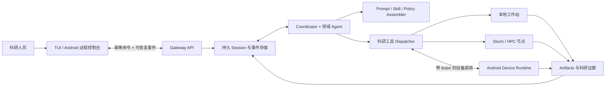

# Cloudra

### 面向计算化学科研的持久、可审计 Agent Runtime

[English](README.md) · [Android 使用教程](docs/ANDROID_USER_GUIDE.md) · [架构说明](docs/PHASE8_NODE_REGISTRY.md) · [生产运维](docs/PHASE8_OPERATIONS.md)

Cloudra 不是问“怎么让 LLM 多调几个工具”，而是在问：**单次对话结束后，Agent 工作流还能不能控制、检查和恢复？**

在 Cloudra 里，文献调研、分子建模、电子结构计算、数据分析、报告写作都以长期 Session 的形式运行。Agent 会指派不同领域角色，等待实验证据或用户决策，向本地机器或 Slurm 集群提交任务，用户离线后也能继续跑。终端和 Android 只是控制界面，真正的状态存在后端。

Cloudra 仍在开发。目前仓库搭好了用于评测的基础设施和验证基础，但不敢声称系统已经能自主保证科研正确、跑赢 benchmark 或可以直接生产上线。

## 研究动机

很多 Agent 演示关心一次运行能不能完成一个小任务。科研工作暴露的是另一组问题：

- 计算任务可能比模型请求、客户端连接甚至服务器进程活得更久；
- 一个听起来合理的回答不能替代可追溯的输入、artifact、日志和计算状态；
- 工具跨越工作站、HPC 调度器和个人设备，不同位置信任边界和资源不同；
- 澄清、审批和中断是科研流程的一部分，不是 UI 偶发异常；
- prompt、工具 schema、文件和软件环境的变化会悄悄破坏可复现性。

Cloudra 从这些约束开始设计系统，而不是在通用聊天机器人外面不断打补丁。

## 设计思路

### 持久化的研究 Session

Conversation、Agent Session、工具调用、审批、交互、artifact 和计算任务都持久记录。事件负责唤醒 worker 和流式更新，数据库仍是权威事实。幂等命令和 event cursor 让客户端断线重连时不会重复执行已经生效的操作。Worker 使用带所有者、过期时间和重试上限的持久 lease；失败必须进入可审计终态，不能一直假装 running。

### 以证据为中心的协作

Coordinator 把研究目标拆给文献、分子量化、周期 DFT、分子动力学、实验、环境管理和写作等领域角色。Supervisor 审阅轨迹并提取可复用案例。研究结果保留与 Session 事件、工具输出、计算文件和不可变 artifact 的关联，而不是只剩一段最终回答。

### 上下文组装保证可复现

每次模型请求前，系统重新组装当前角色、项目策略、记忆、选中技能和完整工具 schema，并在诊断信息里记录 revision。环境 observation 和文件变化不会混入身份 prompt 或篡改旧对话历史。这样 prompt drift 可见，也避免 runtime 更新后悄悄重写过去的实验语义。

### 按能力和位置路由任务

工具和子 Agent 来自显式注册表，无源码的 Android `.pyc` 包里也保持一致。经过验证的 node registry 描述工作区、调度器和命名空间能力。计算可以在本机或 Slurm 执行；Android 则可独立注册能力受限的设备端操作。真正执行操作的一端保留最终拒绝权，可以阻止越权写入、过期 revision 和未授权调用。

### 把人机交互当作状态流转

提问、审批、取消、等待设备和进程中断都是 Session 的一等状态。高风险操作会带着明确目标、参数或 diff 暂停。Android 文件写入、文档访问、相机和分享必须在设备本地授权，服务器 Agent 不能靠构造特殊参数绕过边界。

## 系统概览



系统把三个平面分开：控制面负责用户命令、审批和取消；科研 runtime 负责推理、委派、状态和证据；执行面在真正干活的地方跑。手机断线不会取消服务器计算，设备离线也不耽误 Agent 使用服务器工具。

## 覆盖范围

当前工具与技能生态覆盖：

- 文献检索、文档转换、证据整合与学术写作；
- 分子结构准备、格式转换、可视化和图像到结构工作流；
- Gaussian 输入生成、异步计算提交、状态监控和输出解析；
- NMR 与 IR 数据处理；
- 分子动力学、周期第一性原理、实验设计和科研软件环境的领域规划。

“有工具”不等于“结论正确”。方法选择、收敛性、对照、不确定性与结果解释仍需研究者负责。Cloudra 的目标是保留完成这些审阅所需的证据。

## 已经验证的部分

现有自动化测试覆盖显式注册表、prompt 组装、命令幂等、event cursor、Session 状态机、artifact 边界、权限、设备配对与撤销、worker lease、节点路由、Slurm 命令构造、备份恢复及无源码 Android 打包。

ARM64 开发包位于 `build/apk/cloudra-android.apk`，已检查 ABI、SDK、`.pyc`-only 边界和 APK v2 签名。它使用 Android Debug 证书，不是正式发布身份。

以下证据仍然缺失，因此项目**不作对应声明**：

- 与其他 Agent 或人类基线对比的科研 benchmark 结果；
- Android 真机、厂商后台限制和原生权限矩阵的端到端验收；
- 真实 Slurm 集群上的提交、取消和恢复实验；
- 公网部署、生产签名和长周期运维可靠性。

Android 联调不强制需要公网服务器，同一可信局域网即可。公网访问应使用 HTTPS 或私网组网，不能直接暴露明文开发接口。具体步骤与限制见 [Android 使用教程](docs/ANDROID_USER_GUIDE.md)。

## 快速开始

Cloudra 需要 Python 3.11 或更新版本，以及 OpenAI 兼容的模型服务。

```bash
git clone https://github.com/yyywaa/Cloudra-an-ai-agent-for-chemists.git
cd Cloudra-an-ai-agent-for-chemists
python -m venv .venv
source .venv/bin/activate
pip install -e ".[all]"
cloudra config init
cloudra run "为这个分子设计一个可复现的构象研究方案"
```

开发 checkout 也可以用一键安装脚本：

```bash
./install.sh                 # Linux / macOS
# .\install.ps1              # Windows PowerShell
```

如果集群 home 位于 NFS/Lustre，应把 `CLOUDRA_DATA_DIR` 放到具有可靠文件锁的本地磁盘；SQLite WAL 不能充当多主机共享数据库。

## 使用入口

```bash
cloudra                              # Linux 交互式 TUI
cloudra run "TASK"                  # 运行或继续研究任务
cloudra sessions                    # 检查持久 Session 状态
cloudra history                     # 查看 Conversation
cloudra gui                         # 实验性 Flet GUI（未充分测试，推荐 TUI）
cloudra-api                         # API Server，默认只监听本机
```

Android 远程控制请按 [`docs/ANDROID_USER_GUIDE.md`](docs/ANDROID_USER_GUIDE.md) 操作。备份恢复、设备撤销和 APK 签名检查见 [`docs/PHASE8_OPERATIONS.md`](docs/PHASE8_OPERATIONS.md)，命令与接口速查见 [`docs/CLI_API_REFERENCE.md`](docs/CLI_API_REFERENCE.md)。

## 可复现计算示例

```bash
cloudra run "在当前工作区生成苯的 B3LYP/6-31G(d) Gaussian 输入，并记录方法设置"
cloudra run "异步提交苯的输入文件，并报告 scheduler job identity"
cloudra run "计算结束后解析日志，给出能量、轨道能隙、频率、警告和文件引用"
```

真实计算需要对应科研软件及许可证。Slurm 节点通过验证后的注册表声明，示例见 [`deploy/node-registry.example.json`](deploy/node-registry.example.json)。

## 仓库结构

```text
cloudra/
├── agent.py, react.py          推理与协作编排
├── runtime/                    Session runner、worker 与 prompt 组装
├── session_store.py            持久状态迁移与 lease
├── api.py, api_v1.py           本地和远程控制面
├── nodes.py, slurm.py          能力路由与 HPC 执行
├── artifacts.py                不可变科研产物
├── device/                     Android 能力注册与 runtime
├── tools/, subagents/          显式科研能力与领域角色
├── skills/, prompts/           科研方法与角色策略
└── ui/, tui/                   人类控制界面
```

全部专题文档见 [`docs/`](docs/README.md)。

## 开发、复现与引用

```bash
pytest tests -q
ruff check cloudra tests
```

部分异步 SQLite 测试会暴露特定宿主上的线程回调问题，应分别报告隔离测试与真实 runtime 证据，不能把未正常结束的测试进程当作成功。

Cloudra 目前没有归档 release 或 citation record。用于科研时，请固定 commit hash，并记录模型、prompt、工具 revision、软件环境和计算输入。只有完成对应评测的版本才会加入 citation 文件和 benchmark 报告。

## 许可证

MIT，见 [`pyproject.toml`](pyproject.toml)。
