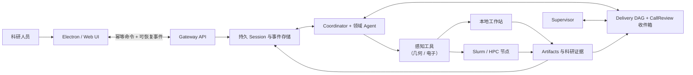

# Cloudra

**面向小分子机理发现的 Agent Runtime：分子的几何与电子感知 × DAG 驱动 harness**

[](https://github.com/yyywaa/Cloudra-an-ai-agent-for-chemists/actions/workflows/ci.yml)
[](pyproject.toml)
[](pyproject.toml)

[English](README.md) · [文档索引](docs/README.md) · [DAG 编排](docs/DAG_ORCHESTRATION.md)

> Cloudra 仍在开发。目前不声称系统能自主保证科研正确或跑赢 benchmark。已验证
> 范围与明确不作声明的证据见[验证现状](#验证现状)。

## 空缺在哪

小分子机理阐明是一条环环相扣的长计算链：原子映射、构象采样、过渡态搜索、
频率、IRC、端点优化、热化学。今天的 LLM Agent 大多把化学当成"调工具 + 写散文"，
在这类研究上有两种典型失败：

1. **感知不到分子。** 放任自流时，模型会手写坐标、凭感觉摆分子取向、凭逐渐
   漂移的记忆转述工具输出的数值。而几何与电子结构——机理恰恰由它们构成——
   正是语言模型看不见的东西。
2. **完成靠宣布，不靠派生。** 机理是否真正确立，由模型自己的总结来判断。
   一段读起来合理的文字代替了 IRC 链接的端点；没有任何持久记录说明哪一步
   建立在哪份证据上。

Cloudra 用两根互相咬合的支柱对症这两种失败：**几何与电子感知层**给 Agent
装上真正作用于分子的眼睛和手；**DAG 驱动 harness** 把机理假设变成可审计的
证据图，完成度算出来，而不是说出来。

这套组合已经**完整跑通了一整个乙烯臭氧化机理寻找**（见
[已验证的端到端能力](#已验证的端到端能力)）。

## 支柱一 —— 分子的几何与电子感知

Cloudra 里的 Agent 从不手写坐标、也不凭记忆转述能量；它们通过结构化工具
*感知*分子，并逐字引用当次工具输出：

- **原子映射**（`reaction_mapping`）：反应物/产物原子映射，带显式绑定状态和
  跟随具体 3D 结构的反应中心 watch pairs。
- **键级感知的结构感知**（`internal_coordinates`）：键长键角异常报告、可旋转
  键分类、立体化学识别、聚焦反应中心的 Z-matrix 编辑——代替 GUI 的"眼睛和手"。
- **不手摆的取向采样**（`conformer_search`）：用 distance filters 锁定反应原子
  对后采样构象系综，双分子接近取向由力场/xtb 弛豫找到，而不是猜出来。
- **电子结构感知**（`electronic_analysis`）：原子电荷、Mayer 键级（识别
  部分成键/初生键）、IBO Lewis 图像、开壳层体系的自旋布居与 ⟨S²⟩ 检查。
- **反应路径工具**：IDPP 插值 TS 初猜、扫描准备/解析、严格 IRC 方向验证，
  以及返回结构化能量、频率和收敛状态的日志解析器。

所有角色都执行同一条硬规则：**禁止手写坐标**——"只是微调几个原子"也没有例外。

## 支柱二 —— DAG 驱动 harness

- **机理图成为可审计的研究对象。** 被研究的路径是持久的 **delivery DAG**——唯一
  的持久图，不是聊天上下文。节点是中间体的 *occurrence*——催化循环和可逆步通过让
  `Cat@entry` 与 `Cat@return` 成为共享同一份 canonical species 记录的不同
  节点来保持图无环。每个节点和边携带类型化引用（`artifact` / `compute_job` /
  `tool_result` / `species`），指向不可变记录；裸文件路径和散文声明都不是证据。
- **每个元素欠什么证据，写在图上。** Coordinator 提交机理草稿时为每个元素声明
  有序的 **stage 契约**（occurrence：geometry/frequency/single_point；基元步：
  ts_guess → ts_opt → frequency → short_irc → 端点 → direction/identity →
  热化学）。阶段严格按序绑定；交付相关的工具结果落入 CallReview 收件箱等待复核，
  不存在第二张"待办"图——没有排产、没有 frontier。
- **完成度由证据派生。** 阶段状态为 `pending / supported / skipped / rejected`，
  元素级证据级别（`structure_supported` → `saddle_supported` →
  `endpoint_supported` → `thermo_annotated`）由确定性 harness 从阶段派生。
  探索性输出（TS 初猜、扫描）最多支撑 advisory 的 ts_guess 阶段；`rejected`
  不是处置，是仍欠的开放缺口。覆盖契约（coverage contract）在图上评估研究能否
  交付；只有用户本人能豁免 gate。
- **事件驱动的 Supervisor。** 引导模式下 Supervisor 接受或驳回机理草稿（接受前
  计算入口保持关闭），并逐条复核收件箱里的交付相关调用、把证据绑定到阶段
  （agree/disagree/skip）。它不能碰机理图结构、不能提升证据级别、不能宣布研究完成。
- **三模式消融边界。** `standard`（零图成本）、`dag_record`（草稿自动接受，
  Coordinator 自绑阶段，无 Supervisor）、`dag_guided`（Supervisor 接受草稿 +
  复核每个交付相关调用）是按会话选择的模式——图簿记本身的效果和 Supervisor
  控制的效果可以分开测量。

两根支柱之下是持久会话基座：幂等命令、可恢复事件游标、带可审计终态的 lease
worker、不可变 artifact、记录在案的 prompt 组装 revision，让以小时到天计的
实验跨过客户端、服务器和进程重启仍然可控、可复现。

## 已验证的端到端能力

Cloudra 已在引导模式下**完整跑通乙烯臭氧化（C₂H₄ + O₃）机理研究**：

- Coordinator 拆解目标，派出文献与领域子 Agent，并把候选机理设计为 delivery DAG
  （含每个元素的阶段契约）；
- Supervisor 接受机理草稿解锁计算，随后复核每一个交付相关调用——反应映射、构象
  采样、TS 搜索、优化+频率、短双向 IRC、端点优化、端点匹配、热化学——把证据
  逐阶段绑定，对失败和不合格证据做出反应；
- 确定性适配器校验每次阶段绑定（顺序、调用成功、非 submit 产物、解析器检查），
  推动中间体和基元步逐级提升证据级别；运行中暴露的 O₃ 强多参考特征和方法敏感性
  问题被记为图注解，而不是被一笔带过；
- 最终交付由确定性覆盖报告把关：声称的基元步达到 endpoint-supported，端点
  经 IRC 链接并完成优化，报告的能量带有明确的级别（level-of-theory）来源说明。

完整轨迹——每一次图变更、操作者、理由和证据引用——都持久化在会话数据库里，
事后可审计。

## 工作方式



三个平面保持分离：控制面负责用户命令、审批和取消；科研 runtime 负责推理、
委派、图状态和证据；执行面在真正干活的地方强制能力边界。细节与不变量见
[`docs/DAG_ORCHESTRATION.md`](docs/DAG_ORCHESTRATION.md)。

## 覆盖范围

当前工具与技能生态覆盖：

- 小分子量子化学：结构准备、构象搜索、TS/IRC 工作流、Gaussian / ORCA 输入
  生成、异步提交、状态监控和日志解析；
- 电子结构分析、原子映射、格式转换、可视化和图像到结构工作流；
- 文献检索、文档转换、证据整合与学术写作，联网搜索（服务商原生或外部工具）
  并附来源引用；
- NMR 与 IR 数据处理；
- 分子动力学、周期第一性原理、实验设计和科研软件环境的领域规划。

"有工具"不等于"结论正确"。方法选择、收敛性、对照、不确定性与结果解释仍需研究者
负责。Cloudra 的目标是保留完成这些审阅所需的证据。

## 验证现状

自动化测试覆盖图存储与变更引擎（无环性、occurrence 节点、不可变证据引用、
原子批次、乐观 revision、分权边界）、确定性交付完成度、模式隔离、会话持久化与
重启恢复、感知工具（原子映射、内坐标、构象搜索、TS/扫描解析、日志解析）、
prompt 组装、命令幂等、artifact 边界、节点路由、Slurm
命令构造和备份恢复。CI 在 CPython 3.11–3.13 上运行全套
测试。上述臭氧化研究是一次已演示的端到端运行，不是 benchmark。

以下证据仍然缺失，因此项目**不作对应声明**：

- 与其他 Agent 或人类基线对比的科研 benchmark 结果；
- 多反应体系上机理发现成功率的系统性评测；
- 真实 Slurm 集群上的提交、取消和恢复实验；
- 公网部署和长周期运维可靠性。

## 安装

Cloudra 需要 Python 3.11 或更新版本，以及 OpenAI 兼容的模型服务。

```bash
git clone https://github.com/yyywaa/Cloudra-an-ai-agent-for-chemists.git
cd Cloudra-an-ai-agent-for-chemists
python -m venv .venv
source .venv/bin/activate
pip install -e ".[all]"
cloudra config init
```

开发 checkout 也可以用一键安装脚本：

```bash
./install.sh                 # Linux / macOS
# .\install.ps1              # Windows PowerShell
```

如果集群 home 位于 NFS/Lustre，应把 `CLOUDRA_DATA_DIR` 放到具有可靠文件锁的本地
磁盘；SQLite WAL 不能充当多主机共享数据库。

### 联网搜索配置

默认 `native_search=auto`：按 `base_url` + `model` 自动识别并启用服务商侧原生
搜索。需要时可用环境变量覆盖：

```bash
export CLOUDRA_COORDINATOR__NATIVE_SEARCH=auto        # off / auto / openai / openrouter / deepseek / gemini / custom
export CLOUDRA_COORDINATOR__NATIVE_SEARCH_PARAMS='{}' # 自定义注入参数（自建中转站用）
```

未启用原生搜索时，Agent 使用外部 `web_search` 工具（Tavily / Brave / Bing /
DuckDuckGo）作为免 key 兜底。启用后外部工具会被剔除，避免双重搜索。

## 使用入口

推荐使用新的 Electron/Web 前端（需要 Node.js >= 18）：

```bash
./install.sh               # 首次：安装 Python 包并初始化配置
cloudra                    # 安装 npm 依赖、构建并启动 Electron
cloudra web --browser      # 或在普通浏览器中打开 SPA
cloudra web --skip-build   # 复用已经构建的 frontend/dist
```

Web UI 提供：按项目隔离的工作区、可在所有平行 Agent 间切换的 AgentBar、
单条事件可追溯的 Inspector、运行中切换 YOLO/模型、审批/交互/产物控制面板，
以及 DAG 面板。

入口：

```bash
cloudra                  # 构建并启动 Electron 前端
cloudra web --browser    # 浏览器模式
```

编排模式按项目选择：`standard`（默认）、`dag_record`、`dag_guided`，
可在 Web UI 的项目设置中切换，DAG 面板展示机理图与复核收件箱。

真实计算需要对应科研软件及许可证。

## 可复现性

用于科研时，请固定 commit hash，并记录模型、prompt、工具 revision、软件环境和
计算输入。runtime 会记录每次 prompt 组装的 revision；DAG 会话还会随 session 保存
Supervisor 模型、prompt revision 与图策略 revision 的快照；每一次图变更的操作者、
理由和 base revision 都留在 append-only 变更日志里。

## 文档

| 文档 | 内容 |
| --- | --- |
| [`docs/DAG_ORCHESTRATION.md`](docs/DAG_ORCHESTRATION.md) | DAG 引导编排：机理图 + 阶段契约、模式、分权、证据派生 |
| [`docs/PHASE8_NODE_REGISTRY.md`](docs/PHASE8_NODE_REGISTRY.md) | 多节点 profile、工作区路由、worker lease、Slurm 语义 |
| [`AGENTS.md`](AGENTS.md) | 仓库地图与开发约定（面向贡献者） |

## 仓库结构

```text
cloudra/
├── core/                       推理循环、Agent 角色、Supervisor
├── services/                   应用服务层与 FastAPI 控制面
├── persistence/                SQLite 持久化、artifact、记忆、路径
├── base/                       数据类与加载器基类
├── infra/                      配置、LLM 传输、事件、平台支撑
├── dag/                        DAG 驱动 harness（可选，按会话开启）
├── runtime/                    Session runner、worker 与 prompt 组装
├── device/                     Android 能力注册与 runtime
├── tools/, subagents/          感知工具、科研能力与领域角色
├── skills/, prompts/           科研方法与角色策略
└── frontend/, ui/              人类控制界面
```

## 开发

```bash
uv run pytest -q tests/            # 全套测试
uv run ruff check cloudra tests    # lint（line-length 120）
```

## 引用

Cloudra 目前没有归档 release。在归档版本发布前，请连同使用的确切 commit 一起
引用本仓库：

```bibtex
@misc{cloudra,
  title  = {Cloudra: An Agent Runtime for Small-Molecule Mechanism Discovery},
  author = {{Cloudra Developers}},
  year   = {2026},
  url    = {https://github.com/yyywaa/Cloudra-an-ai-agent-for-chemists},
  note   = {Commit-pinned research software; see repository README for evaluation status}
}
```

只有完成对应评测的版本才会加入正式 citation 文件和 benchmark 报告。

## 许可证

MIT，见 [`pyproject.toml`](pyproject.toml)。
