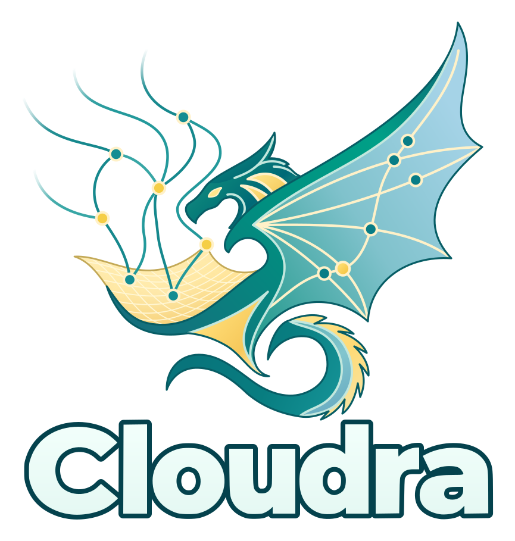

# Cloudra

<p align="center">
  
</p>

[](https://github.com/yyywaa/Cloudra-mechanism-agent/actions/workflows/ci.yml)
[](pyproject.toml)
[](LICENSE)

[English](README.md) · [使用文档](docs/README.md) · [论文与数据](docs/RESEARCH_DATA_CN.md) · [参与开发](CONTRIBUTING.md)

**面向有机小分子反应机理探索的计算化学智能体。**

Cloudra 把模型、化学工具和量子化学计算连接起来，协助研究者提出机理假设、准备结构、搜索过渡态，并检查计算证据。你可以用自然语言提出研究任务，在同一个工作区查看研究过程、计算作业和交付文件。

我们希望研究过程留下可检查的依据：结构来自哪里，计算采用什么方法，哪些路径得到了支持，哪些问题还没有解决。Cloudra 用机理图关联物种、反应步骤与计算证据；报告中的判断仍需要结合原始结果审阅。

## 可以怎样使用

一个起点是研究一条具体的反应路径。准备好反应物与产物结构，在项目中说明理论级别、溶剂、可用计算节点和资源范围，然后提交任务，例如：

> 请研究工作区中这组反应物到产物的反应路径。先检查结构、原子对应、电荷和自旋，再按我指定的方法寻找过渡态，并用频率分析和双向 IRC 检查连接关系。报告计算依据、结果文件以及尚未解决的问题；需要改变方法或扩大计算范围时先与我确认。

这是任务写法示例，不是已完成的计算案例。实际运行需要可用的模型和量子化学软件，会产生模型调用及计算资源开销。

研究过程中可以查看 Agent 的讨论与工具结果、计算队列和原生日志。使用机理图模式时，还可以查看物种、反应步骤及其证据状态。阅读最终报告时，沿文件引用检查结构、频率和路径结果；一次作业正常结束不等于整条机理已经得到验证。

## 安装与启动

需要 **Linux 或 macOS、Python ≥ 3.11、Node.js ≥ 22**，以及可用的语言模型服务。量子化学软件按研究任务另行安装和配置，例如 ORCA、Gaussian、xTB 或 CREST。

```bash
git clone https://github.com/yyywaa/Cloudra-mechanism-agent.git
cd Cloudra-mechanism-agent
./install.sh

# 安装时选择默认的 .venv 后，在当前终端激活它
source .venv/bin/activate

# 安装默认 JavaScript 工具运行环境的依赖
npm ci --prefix cloudra/runtime_v2/js_host --ignore-scripts --no-audit --no-fund

# 构建前端并启动 Web 界面
cloudra
```

安装脚本会引导初始化配置。启动后打开终端显示的地址，默认是 `127.0.0.1:8000`。

1. 在全局设置中配置主 Agent 与协作 Agent 的模型。可使用 OpenAI 兼容接口，也可选择 ChatGPT / Codex 账号登录。
2. 配置研究所需的计算软件和节点；远端计算见[部署指南](docs/README.md#部署与配置)。
3. 创建项目，选择工作目录，放入结构或已有计算文件，说明任务及计算范围后开始研究。

模型登录、联网搜索、常用命令及远程访问设置见[配置指南](docs/CONFIGURATION_CN.md)。

## 三种工作模式

在项目设置中选择：

| 模式 | 适合怎样的工作 |
| --- | --- |
| `standard`（默认） | 使用化学工具开展研究，不要求通过交付图组织证据。 |
| `dag_record` | 用机理图记录物种、反应步骤和证据，由执行 Agent 绑定结果。 |
| `dag_guided` | 在机理图基础上，由独立 Supervisor 审阅机理草稿和提交的结论。 |

选择模式不会替代科学验证。具体的图交付机制见 [DAG 说明](docs/DAG_ORCHESTRATION.md)，过渡态流程及证据要求见 [TS 指南](docs/TS_PROCESS_SOP.md)。

## 论文、数据与复现

论文 **Cloudra: Geometric Reasoning and Scientific Validation for Autonomous Reaction Mechanism Exploration** 正在准备提交 arXiv。仓库保留[中英文论文源文件及 SI](paper/overleaf/README.md)；正式链接将在发布后补充。

[研究数据与复现入口](docs/RESEARCH_DATA_CN.md)按用途区分：复现论文图表、检查 Agent 原始运行、审查 Gold 参考计算，以及重新运行 Benchmark。正式题库含 50 题；P2 对应四种配置、200 次保留运行。P2 完整归档的上传进度以[交付页](docs/benchmarks/P2_DELIVERY.md)为准。

## 参与与引用

欢迎提交问题、使用反馈和改进建议。报告计算问题时，附上软件版本、任务描述、输入文件及相关日志，会更容易定位原因。开发约定见 [CONTRIBUTING.md](CONTRIBUTING.md)，系统结构见[架构说明](docs/ARCHITECTURE.md)。

使用本项目开展研究时，请引用论文，并记录所用软件提交版本：

> Chengyi Yang, Qianxin Zhou, and Yang Li. *Cloudra: Geometric Reasoning and Scientific Validation for Autonomous Reaction Mechanism Exploration*. Working draft, 31 October 2026.

Qianxin Zhou 与 Yang Li 为共同第二作者。[BibTeX](CITATION.bib) · [GitHub 引用信息](CITATION.cff)。arXiv 编号将在正式发布后补充。

## 许可证

Cloudra 采用 [AGPL-3.0-or-later](LICENSE)，按许可证约定提供，不作担保。`cloudra/skills/` 中声明 MIT 的技能使用 MIT 许可证；随仓库分发的第三方组件保留各自许可证，见[第三方归属](docs/licenses/README.md)。贡献采用 Developer Certificate of Origin，提交时请签署 `git commit -s`。
