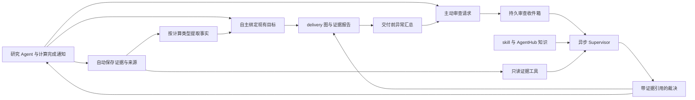

# DAG 效率改造：证据先保存，复核按问题发生

日期：2026-09-04。状态：架构提案，尚未实施。配套执行清单见 [implementation plan](../plans/2026-09-04-dag-evidence-review.md)。

## 1. 要实现什么

Agent 自主开展研究、保存和绑定证据，在需要科学判断时主动给 Supervisor 发审查请求。系统保证可观察证据留存，并在交付前汇总缺口与矛盾。Supervisor 根据任务要回答的问题、实际证据和方法适用范围作判断；它可以查文件、skill 和 AgentHub，不再逐个批准普通工具调用。

这次改造的重点是把科学判断写清楚，并修复妨碍这些判断落实的接口。保留现有 delivery DAG、计算调度器、知识库和事件内核，不引入新的科研工作流引擎。

### 已与用户对齐

| 决策 | 明确边界 |
| --- | --- |
| Agent 自主送审 | Agent 选择送哪些问题、证据与反证；普通计算完成不自动启动一次 LLM 审查。 |
| 防止漏证据 | 系统在交付前自动汇总遗漏、冲突等异常；不把全部计算重新送审。 |
| Partial／方法受限退出 | dag_guided 下必须经 Supervisor 同意；不能通过把 stop 改成 partial 绕过它。 |
| 科学退出判据 | 主要通过 prompt 和 skill 改善；Supervisor 可调用 skill、AgentHub、读取实际证据。不能只因图没填满就拒绝退出。 |
| 乱序 | 必须支持证据乱序到达和绑定。科学依赖仍要满足，但不要求工具执行或绑定按阶段列表排队。 |
| AgentHub | 是项目协作与本地知识库的共同入口；增加使用价值和可达性，同时减少重复查询及长等待。 |
| Supervisor 文件权限 | 先开放读取与解析工具；不开放临时 Python，不得修改科研文件或提交计算。 |

此前已修改的计算 skill、SOP 和普通角色 AgentHub prompt 作为工作基础；不把这些文本改动描述成运行时已经改造完成。

## 2. 诊断依据，以及不应误判的地方

代码基线：HEAD 3811c04d6aba6856e343962c5bc569d8fc794912，另含当前工作区尚未提交的 skill／prompt 等修改。

NA1 诊断使用本地快照 /tmp/cloudra-na1-review，而非宣称最新完整运行。事件区间为 2026-09-04 04:38:33–08:14:13 UTC；快照在本地约 16:39 取得。重新核对得到 63 个作业（47 done、16 failed），88 个 CallReview（62 ignored、22 reviewed、4 pending），74 个 Supervisor session。ignored 占约 70.5%，说明审查输入中存在大量低价值条目；这些观测不单独证明 DAG 是全部延迟的原因，也不能把 Supervisor 时长相加当作可节约的总墙钟时间。

| 问题 | 实现依据 | 改造含义 |
| --- | --- | --- |
| 普通计算串行等待审查 | cloudra/dag/evidence_inbox.py 的 on_tool_finished → _wake_supervisor_for_reviews → maybe_supervise；guided 模式的 dag_bind_evidence 仍是送审 | 修改 prompt 不会消除 await；需要把入箱与执行审查拆开。 |
| 审查按调用碎片化 | CallReview 一行一个调用，review_call 一个目标一个阶段；supervision.py 聚合的主要是 trigger 字符串 | 审查单位应是一个问题及其证据集合，不能丢掉请求正文。 |
| 绑定顺序拖慢交付 | engine.py 的 apply_stage_verdict 检查所有前置 required 阶段 | 取消时间顺序门禁；改为根据完整证据集合计算结论是否成立。 |
| 乱序存在隐藏正确性风险 | models.py 的 derive_evidence_level 见 thermochemistry 就可升到 thermo_annotated；not_applicable 也进入 satisfied | 不能只删除 stage_out_of_order；必须同时修正证据等级推导。 |
| 身份检查并非全被删掉 | reaction_mapping.py 的 _identity_and_binding、derive_delivery_changes 仍在；796f392 改造前的自动派生链路已改变；当前绑定的专门科学守卫主要是 saddle 检查 | 恢复类型化身份结果的消费，不恢复旧 process graph。 |
| 身份与原子映射耦合 | endpoint_identity_match 派生要求 binding_status=complete 且两端 identity=match | 对称导致映射不唯一，不等于物种不对；物种不对也不能当作普通“无证据”忽略。 |
| ORCA 参数表达失真 | qm_input_writer 的 ORCA task_type 翻译只支持少量键，其余子选项可被静默丢弃 | 原生设置和不支持项必须明确；输入生成与生成后的语义检查共用结构。 |
| Supervisor 能力接线不完整 | core/supervisor.py 的工具发现和执行均筛 dag_*；runtime_v2 的 supervisor 仅是 UI 壳 | 只修改 roles.py 或 prompt 不会让 skill／Hub／解析工具真的可用。 |
| AgentHub 通知不等于及时消费 | hub_bridge 能投递，但 subagent_swarm 默认 await 全部结果；父 agent 无法越过未返回的工具处理通知 | 修复委派的等待方式；不能单纯归因于检索性能。 |
| 非阻塞 swarm 还有并发漏洞 | is_wait=false 时 semaphore 只覆盖 spawn，不能约束实际运行的子 agent 数量 | 不能只翻默认值；需要让并发许可覆盖整个子任务生命周期。 |
| 退出目前可绕过审查 | stop_audit.py 只在 complete 且覆盖不足时触发审查，partial 可直接落账 | 增加明确的退出审批语义，区分等待、研究结论与运行异常。 |

NA1 中约束优化加单虚频被视为 TS、IRC 端点错物种未形成有效反证等现象，应成为固定回归案例。issue #27 中关于工具不便和参数遗漏的意见，应逐项以输入生成及解析 fixture 验证；“另一次运行更快”仅作为待验证假设，不直接作为设计事实。

## 3. 方案选择与边界

三个可选方向：

1. 只改 prompt：投入小，能改善科学判断，但无法解除同步审查、顺序绑定和父 agent 阻塞。
2. 保留 Supervisor 对所有证据的批准权，仅批量审查：调用次数下降，仍把日常交付压在一个 LLM 上。
3. **推荐：事实留存与绑定由 harness 保障，疑难判断与退出由 Supervisor 复核。** prompt／skill 承载科学策略，少量确定性机制负责可靠性与权限。

保留三种模式：standard 不启用 DAG；dag_record 自动接受草稿并确定性记录证据，不启动 Supervisor；dag_guided 增加草稿审批、按需审查、退出审批。本文要求 Supervisor 同意退出，适用于 dag_guided；dag_record 的 partial 必须明确标记为未获科学督导复核。

### 全局约束

- Python >= 3.11；POSIX-only；前端保持现有 React/TypeScript。
- delivery 图及其 journal 继续由 DagStore/DagEngine 管理；不恢复 process graph。
- runtime_v2 的可恢复状态只通过事件和 apply_event 变更；不直接修改 core 投影。
- 工具语义只在 tools/registry.py 声明，通过 tools/capabilities.py 消费；不新增散落的工具名白名单。
- scheduler 与中央 compute.db 保持现有职责；资源调度不通过解析输入文件推断。
- 复用 ArtifactService 与现有 chem-kb/provider；不建设第二个产物仓库或知识库。
- 模型可见工具说明、错误与 prompt 用英文；设计文档用中文。
- 保留旧 journal、证据、裁决的历史可读性；不得把旧记录无验证地升级成新标准已验证证据。
- 本轮仅提交设计与计划；不运行新的化学作业、不改评分权重、不提交或覆盖无关工作区变更。

## 4. 核心架构：三件事分别负责

**保存**回答“发生了什么、原始结果在哪里”；**绑定**回答“这份结果和哪个结论有关”；**审查**回答“这组证据能否支持该科学解释，是否值得继续”。绑定成功不表示 Supervisor 已赞同，也不表示物理问题已被完整证明。

现有 DAG 单一权威不变。新增的事实记录、绑定关联、审查请求都放在会话 DAG 存储中，与已有 journal 协作。runtime_v2 仅管理审查 worker 的执行、通知和生命周期；不复制一份审查状态机到 core。

## 5. 任务分类先确定要证明什么

把“科学问题”和“实际作业类型”分开，避免看到一个 freq 日志就套固定完整流程。

### 5.1 交付契约 ClaimSpec

扩展现有 StageContract，增加 claim_spec 与 contract_version=2。ClaimSpec 至少包含：

- kind：mechanism / electronic_barrier / free_energy_barrier / selectivity / property。
- quantity、unit、reference：具体请求量、单位、参照物种或复合物；非数值任务可无单位。
- scope：目标元素、方法与环境要求、温度及标准态（如适用）。
- required_checks：任务需要的检验集合；可解释的 optional_checks；对每项豁免记录理由和批准来源。

Coordinator 在草稿中提出契约，Supervisor 接受时检查其科学合理性。接受后，降低要求、删除必需检查或改变所回答的问题必须作为范围变更重新审批；不能自行把电子能垒改成结构展示来获得 complete。新增普通证据、修正显示标签不触发这种审批。不能依赖 benchmark gold 决定验证范围；gold 只属于评分侧。

| 要回答的问题 | 契约重点 | 不应机械增加的要求 |
| --- | --- | --- |
| 结构或稳定中间体 | 几何来源、极小值判据、目标物种身份、方法适用性 | 没有反应通道声明时，不要求 IRC。 |
| TS／连接关系 | 驻点证据、相关虚频模态、路径两侧与目标端点身份；短 IRC 是否足够按现有结果判断 | 不因固定点数不足而要求重算已经收敛且连接证据充分的路径。 |
| 电子能垒 | 上述通道证据与同口径电子能差、参照态 | 不把 RRHO 自由能校正当成电子能垒的必需项。 |
| 自由能垒 | 对应温度、标准态、热修正及适用性，与电子能来源的组合关系 | 不接受混用不同参照或把 ΔE 冒充 ΔG。 |
| 选择性 | 两条竞争通道、可比的参照和统计口径 | 不能只验证一个 TS 就宣称 ΔΔG。 |
| 当前方法不可信 | 所请求量与方法能力的具体冲突、已知适用边界、现有诊断和缺口 | 不能强迫 MLIP 提供其接口不存在的波函数诊断，也不能以一次不收敛证明方法失效。 |

这里的检查是结论成立所需的证据条件，不等同于每项都要求一次新计算；已有兼容产物优先复用。

### 5.2 CalculationIntent 与实际观测

计算输入归一化为 CalculationIntent：engine、engine_version、provider、tasks、constraints、charge、multiplicity、method_signature、geometry_ref。provider 与 tasks 正交，ExtOpt 不等于 TS。

输入生成、提交检查和日志解析共享同一语义模型；各引擎保留原生控制项。输入宣称的 task 与日志观测分别保留，冲突时记录异常，不能相信文件名或 Agent 自述来覆盖原始文件。无法判断的字段为 unknown，不能补成通过。

类型识别在生成／提交时做，科学有效性按类型在结果解析／绑定时检查。初始分类不能替代收敛、模态、端点和身份等结果验证。

## 6. 保存所有可观察证据，保留反证

沿用 dag_evidence_records 与 ArtifactService，补齐以下能力：

1. tool_call_id、compute_job_id、artifact hash 建立索引；取消 resolve_evidence_for_call 全表 JSON 扫描。
2. 每次实际计算尝试有独立身份。重复解析同一文件去重，但重跑一次真实计算不能被误去重。
3. 保存输入、关键输出、最终／端点几何、解析版本的不可变引用。作业终态收集核心证据，较大轨迹按使用需求登记；尚未保存的文件明确标为 unavailable，不能假装可复查。
4. 工具失败也记录；失败日志、错误产物、结构不匹配都可放进审查包。成功标志只表示工具调用状态，不替代科学有效性。
5. 在现有 registry 上添加事实适配器声明。适配器返回 EvidenceFact：check、outcome=supports/refutes/inconclusive、subject、source_refs、details、adapter_version。
6. 优化收敛、几何 hash、约束、频率／模态、路径方向、物种身份、能量与热修正分别记录。不能用一条模糊的“计算成功”替代它们。

绑定表允许一个事实用于多个声明，一个声明有多份支持／反证。StageState 是当前摘要，历史支持不能被后一次绑定覆盖删除。显式 supersede 需理由和证据引用；历史仍可审计。

外部路径与 Slurm 结果可能尚不可访问：返回 evidence_unavailable 并保留待收集状态，待文件到位重试收集，禁止反复触发 LLM。每次收集失败可见，不能吞异常后继续把图标绿。

### 防遗漏的实际边界

系统能保障被工具、提交记录和产物收集器观察到的证据留存，不能承诺发现任意工作目录中未登记文件所含的全部科学意义。交付前输出四类异常：

- 声明缺必需检查，或引用已失效／不可读取。
- 同一候选／结论存在尚未解释的反证或版本冲突。
- 已登记且有明确 target 提示的交付相关事实尚未绑定。
- 无 target 的关键事实待归属：按类型、调用、作业压缩成待归属列表，由 Coordinator 分类；相关性仍不清楚的条目作为异常送 Supervisor。

明显无关的记录可 disposition=not_relevant-with-reason。系统记录处置，不以“所有文件都必须送审”补偿相关性不确定。普通失败尝试在已明确被替代且不反驳当前结论时，不永久阻断交付；原始证据保留。

## 7. 乱序绑定：接收顺序自由，结论有条件

继续使用现有 StageKind 词表和 delivery 元素。stages 的列表顺序仅作展示，不作为绑定门禁。

例：frequency → identity → ts_opt 三份证据依次到达。frequency 可以立即登记和绑定；在缺少同一几何的驻点证据时，TS 结论显示“缺驻点验证”，不拒绝这次绑定。ts_opt 到达后自动重算依赖；不要求 Agent 再交一次 frequency。

规则：

- 对每份事实独立判断；对每个结论检查完整需求集合。需求要绑定具体主体，例如 identity(endpoint_a) 与 identity(endpoint_b) 是两项；不能仅因出现过一次 identity 就认为两端均通过。禁止通过先绑定 thermochemistry 跳到最高证据级别。
- 关联由 geometry hash、方法签名、路径起点／端点、物种与参照态构成。A 几何的 opt 与 B 几何的频率不能拼成有效 TS。
- 允许明示复合方法：例如低级别几何／热校正加高级别 SP，必须在契约中声明组合；不能以“所有方法签名必须相同”误杀正常工作流。
- supports、refutes 和 inconclusive 是证据事实的判断；是否已复核是另一字段。反证存在时相关声明 unresolved，不隐藏已有支持。
- skipped／not_applicable 是范围处置，不是正证据。可以帮助明确交付范围，不能抬升科学证据等级。
- required_checks 组成固定、版本化的依赖关系；不允许 Agent 动态造一个任意执行 DAG。
- 一个批次的多阶段绑定用同一事务与 expected_revision 提交；冲突返回可重试的 revision_conflict，不触发重新计算。

旧的 evidence_level 继续用于兼容展示，新版完整性判断以 checks 和科学结论的 requirements 为准，不用单一等级掩盖“端点已确认但热校正缺失”等独立维度。

## 8. 物种身份：恢复链路，分清三种结论

复用 reaction_mapping 的实际结构识别，不写第二套分子判定器：

- identity_match：给定端点与目标物种一致，可支持对应 identity 检查。
- identity_mismatch：明确反证。展示实际／预期物种和结构引用，标出受影响的节点／边；停止把它作为目标路径继续精修的建议进入 prompt。
- identity_inconclusive：工具或方法尚不足以判定；保留原因。对称原子的具体对应不唯一可以与 identity_match 同时存在。

原子映射的要求取决于声明：要解释具体键变化、立体结果、同位素去向时，映射歧义可能仍是实质缺口；仅确认分子身份时，不应因此重新优化或跑 IRC。

比较必须包含电荷、自旋、组成与任务相关立体化学；对多片段体系按所声明的完整组成判断，不能丢掉 CH4 等额外片段后算作匹配。原子序号混淆的修复优先做索引核对，不重新做电子结构计算。

## 9. 按需审查与可靠收件箱

### 9.1 尽量保持工具面小

| 接口 | 新语义 |
| --- | --- |
| dag_bind_evidence | 两种 DAG 模式均立即尝试确定性绑定；支持同一调用对应多检查的批量附件；不自动等待 Supervisor。研究 Agent 可向项目现有目标提交证据，只有 Coordinator 改结构／契约。 |
| dag_message_supervisor | 扩展为结构化请求：kind、question、target_ids、evidence_refs、反证、建议动作；返回 request_id。普通研究 Agent 可请求审查，项目退出请求只能由 Coordinator 提出。 |
| dag_review_evidence（替换 dag_review_call） | Supervisor 对一个请求提交一组裁决，以及下一步或退出决定；裁决通过 DagEngine 生效。旧调用仅供历史解析，不再向新 run 暴露两个同义工具。 |
| dag_view / dag_view_evidence / dag_delivery_report | 查询分页摘要、原始引用、验证缺口和待审请求；不自动把整个收件箱塞进 prompt。 |

ReviewRequest 的最小内容：request_id、kind=draft/evidence/exception/exit、requester、scope、question、supporting_refs、counterevidence_refs、basis_fingerprint、created_at。fingerprint 基于有关目标版本、契约版本和证据 hash，不用整个项目 revision 使无关变化反复作废审批。服务端按 scope 补入已经登记的相关反证及未决异常；Agent 选择问题与重点，不能靠省略反证引用改变 Supervisor 所见的事实。

### 9.2 触发和执行

仅在草稿审批、主动请求、确定性重大矛盾、交付前异常汇总、退出申请时入箱。普通 add/ref、普通计算结束不唤醒 Supervisor。相同 scope 与证据指纹合并；新反证或用户更新不能被旧请求去重吃掉。

请求状态：queued → running → resolved；失败可 retryable_failed，依据变化可 superseded。用 DagStore 事务记录请求、裁决及待通知标记。每项目最多一个审查 worker，由 runtime_v2 负责调度；该队列不与计算作业共用 compute.db。

worker claim 带租约或等价的进程重启回收语义，活跃处理期间续租，失去租约的 worker 不能提交裁决。单次审查有轮次与时间预算，计入项目总预算；超限保留请求和已得证据，不伪造科学决定。一次失败按运行时可配置上限退避，达到上限显示 review_unavailable；保持未批准状态，不自动同意，也不驱使研究 Agent 无限重提。重启恢复未完成请求、未通知裁决；运行内存锁仅用于加速，不作为唯一权威。

审查结束后按 request_id／decision_id 投递可去重通知。研究 Agent 在可消费消息的轮次边界处理，等待审查时不占住一个长时间工具 await。草稿尚未接受时保持现有实质计算门禁；“已入箱”不能当作“已批准”。

## 10. Supervisor 的科学判断主要写进 prompt 与 skill

### 10.1 一次审查的顺序

1. 明确当前问题、方法约束、请求量、参照和本次需要决定的事。
2. 加载匹配 skill 与所需 reference；同版本已加载则复用。
3. 先读当前证据包与确定性检查，再查原始日志／输入／结构；按未决问题选择额外检查。
4. 对陌生方法、关键词、方法边界或新型失败，用 AgentHub 搜本地知识和项目经验。读取出处、适用条件、证据等级与反驳记录；知识条目本身不等于本项目已验证结果。
5. 区分四类原因：输入／工具故障、局部搜索失败、方法适用性不足、证据已经足够但形式流程未填满。
6. 给出有证据引用的决定。若要求继续，必须指出缺什么、可执行的动作、预期新增信息，以及为何此前证据不能回答；若同意退出，说明已成立结论、未解决部分、理由和不得声称的数值。

### 10.2 必须写进 prompt 的判据

| 场景 | Supervisor 应怎样判断 |
| --- | --- |
| 约束 Opt 得到一个虚频 | 先核查是否驻点、约束是否解除及模态是否对应反应；单虚频不能单独授权 TS 结论。 |
| OptTS 反复返回同一盆地 | 查尝试记录；鼓励一次有明确目的的构型／反应坐标／柔性扫描调整，不默认继续放大 MaxIter 或微调参数。 |
| 一维扫描单调 | 可说明该扫描坐标下未找到峰；不能直接证明无能垒。 |
| IRC 已收敛但不足固定点数 | 根据收敛、端点优化、身份及路径连接证据判断；不给无信息增益的“补点”任务。 |
| 端点身份不对 | 作为路径反证处理，不在错误产物上继续精修然后命名为目标产物。 |
| MLIP 下需要它不支持的物理量 | 查模型适用范围及可用证据；不要求无法输出的诊断，不以方法名称直接一票否决。 |
| 申请 partial／拒答 | 区分“当前没有找到”与“当前方法不能可靠回答”；证据不足时可以否决申请，但必须给具体且可执行的下一步。 |
| 已有足够证据 | 认可正确复用和合理契约，不为了增加阶段数量要求重复计算。 |

尝试记录放在现有工作区／证据包中，列“假设、动作、结果、下一次为何会带来新信息”。重复次数是提示重新诊断的触发条件，不是通用科学拒答阈值。首版不新增机器学习策略控制器、固定最大失败次数规则或按模型名称硬编码可信度。

### 10.3 工具可用性必须真的接上

Supervisor 的私有 runner 同时修改工具发现和调用执行：通过 registry capability 获取可用项；get_skill 复用现有 loader；AgentHub 走 runtime_v2 原生 bridge，不能落入 legacy 工具空实现。

只读证据能力提供文件列表／受限文本读取、输入与日志解析、已登记结构的身份核对。读取限定到项目工作区与允许的不可变证据根目录；不得跨项目或跟随越界 symlink。可能写文件的现有解析工具必须先拆出纯读取路径，不能只因 is_read=True 就原样开放。

AgentHub 的 search/browse/read/directory 开放；允许 post 提问／说明裁决，但它只是协作记录。call 若开放，仅允许已有会话，禁止隐式 spawn。review 与 Hub 通信属于明确授权的控制面写入，不是对科研文件的写操作。

本次不开放任意 Python 或 Bash。这里的只读沙箱是执行层受控的读取／解析能力集合，不声称已经具备任意代码的操作系统隔离。以后如果扩展脚本能力，需要单独设计真实执行隔离；本次不预建这套设施。

## 11. 退出：Supervisor 决定科学范围，系统执行门禁

分开三个维度：运行状态、交付范围、科学结论。运行报错不等于方法不适用；partial 不等于完整解决；审批通过 partial 不把遗漏的阶段改成 supported。

dag_guided 最终退出规则：

1. complete：确定性完整性通过，且无影响当前结论的未决异常／审查。无异常的常规交付不必再等一次全量 Supervisor 复核。
2. partial／method_limited：必须有匹配当前科学范围与相关证据版本的 Supervisor 批准。完整保留缺口与理由，报告同时显示 approval 与 scientific_status。
3. 用户明确要求停止：user_terminated 可以停止；必须有真实用户停止事件或命令来源，不能仅信任模型自填枚举。
4. 超时、额度不足、Supervisor 不可用或运行崩溃：记录 operational_failure／awaiting_review 等运行原因，不伪造批准或科学拒答。

StopGate 返回 allow_final / wait_background / wait_review / needs_work。需要复核时创建或复用请求并挂起，审批到达再继续；不能把“Supervisor 壳在 running”计入普通后台任务从而跳过退出门禁。普通 stop 等作业继续保留等待语义，但不产生已获批准的最终交付。

否决退出必须附缺失证据和可执行下一步；同一依据下重复申请复用原裁决。新反证、任务范围变化可发新请求。硬预算已耗尽时不能凭否决要求额外花费：任务进入明确的未获批准／运行受限状态，必要时向用户解释，不能循环重启研究。

## 12. AgentHub：先让消息及时被处理

### 12.1 修复并行委派

subagent_launcher／swarm 默认立即返回会话或任务组标识，父 Agent 可以处理新消息。保持现有 max_concurrency 含义：并发许可覆盖子任务从启动到终态，而非仅 spawn 调用。增加轻量 launch group，复用 CommandBus 的 spawn/cancel；它管理 Agent 并发，不调度化学作业。

旧 is_wait=true 显式调用仍可用，但在相关消息到达时允许提前返回“任务尚在运行＋状态引用”，而不是隐藏通知直到整个 swarm 结束；工具说明与返回 schema 要同步更新。停止父 run 与用户取消任务分开：暂停不取消子 Agent，明确取消才按现有父子关系级联。

修复 _await_terminal 的检查／订阅竞争；任务终态、取消、重启恢复均须释放并发许可。launch group 的成员与生命周期通过事件重放恢复，不能依赖活 coroutine 重建剩余工作。

### 12.2 检索与通信契约

- 修正 post_id／parent_id 的字符串事件 ID 与 schema 整数类型不一致；directory 只描述真实返回字段。
- search 明确返回项目 posts、本地 library、查询范围与 provider 状态；知识库未安装或服务失败时明确说明局部不可用，不伪装无知识命中。
- 优先直接查已有证据／帖子的 ID；新任务、新不确定性和新失败才针对性检索。已有结果连同来源传给下一 Agent，避免所有人重复搜同一句话。
- browse 支持 cursor／since；先改善增量获取和索引，再按性能数据决定是否加查询缓存。首版不引入跨 provider 的全局缓存失效协议。
- 关键消息包含 target、finding、evidence_refs、consequence、requested_action。公开贴仅摘要，附件引用原始记录；不会自动写入全局知识库。
- 普通 mailbox 继续是运行内队列。对关键 Hub 帖子，用事件与消费游标恢复尚未处理的定向通知；审查请求则始终以 DAG 持久收件箱为准。无需把所有历史聊天都重新入队。
- 记录 delivered_at 与 consumed_at 的边界；consumed 表示进入模型上下文，不等于已经理解或照做。用这个指标定位“消息投了但父 agent 很久没看”。

## 13. ORCA：清晰的原生接口与任务语义

目标不是把 Gaussian 的任意 route 子选项自动翻译成 ORCA，而是让常用意图有可靠的结构化表达，其他原生参数清楚透传或明确拒绝。

### 首批必做

1. 引入共享 CalculationIntent 与每引擎 builder。保留 qm_input_writer 入口；完成 minimum_opt、ts_opt、frequency（analytic/numeric）、single_point、irc、relaxed_scan 的明确映射。
2. 旧 task_type 可解析已支持项；不支持的键／子选项返回具体字段和原生替代建议，禁止静默丢弃。原生 orca_blocks 仍可用，但重复／冲突的核心任务设置要报错。
3. 数值 Hessian 与频率是独立选项；ExtOpt 的 provider 信息与任务分开；不自动带入 DFT method/basis。使用实际安装的引擎版本，不以文档版本冒充运行版本。
4. TS 输入不能无提示继承 scan/constraint；若用户确有约束鞍点需求，结果只能声明对应受限问题，不自动算作完整空间的 TS。
5. 统一资源语义：writer 给出总内存、nproc、ORCA per-process maxcore 与所需开销说明；submit 继续显式申请 cpus/memory_mb，检查低报资源，不能静默超额或任意放大到节点上限。
6. 修复 ORCA title/provenance 注释与声明不符；SMILES 来源注释必须区别“用户期望结构”与“已验证身份”，不能靠写一条 smiles 注释制造证据。
7. scan_parse 候选的能量和坐标必须来自同一扫描点。只有末帧但不知峰值坐标时返回 candidate_unavailable，保留能量曲线，不拿末帧假装峰值。
8. 让 ts_guess strict 检查消费 ORCA 原生 IRC 轨迹／端点，复用 orca_frames；不为解析器缺功能要求重算已完成的 IRC。
9. 同一适配边界上的 Gaussian scan_start 修复：请求起点与实际几何不符时要明确处理／拒绝，不能仅改步长让输入看起来正确。

无需在本轮完成所有 ORCA 关键词封装或建立新量化化学 DSL。自由能处理支持情况在能力输出中明确；ORCA raw-RRHO 扩展只有在目标任务需要时作为单独可验收工作项，不能在缺少实现时默默回落 Gaussian 路径。

原生语法依据沿用 [ORCA 输入参考](../../../cloudra/skills/dft-calculation/references/orca-inputs.md) 中已经核对的官方手册链接；执行时按安装版本复核新增参数。回归检查使用仓库固定文件，不要求每次联网或调用真实 ORCA。

## 14. 持久化、展示与迁移

### 权威归属

| 数据 | 唯一权威 | 可重建内容 |
| --- | --- | --- |
| delivery、契约、证据绑定 | DagStore + DagEngine journal | 图视图、checks、coverage |
| 证据文件 | ArtifactService 不可变产物 | 解析缓存、摘要 |
| 事实、审查请求、裁决与通知状态 | 会话 DAG 表；通过事务与 journal 关联 | Supervisor 当前 prompt、内存锁、worker task |
| Agent／launch group、Hub 消费游标 | runtime_v2 EventLog + apply_event | 调度任务、运行内邮箱提示 |
| 计算作业 | 中央 compute.db | 通知视图 |
| 本地知识与项目讨论 | chem-kb/provider；Hub 事件分别管理 | 搜索结果、摘要 |

新 schema 增量迁移，不清空旧会话。旧 CallReview 保留只读；待审旧条目转换为一个有来源的历史审查请求，不重复启动几十轮。旧裁决显示 legacy_reviewed；新检查未执行的字段 unknown，明确可通过离线重解析补齐，不能批量盖“verified”。旧 StageContract 版本保留，恢复历史数据不立即重新审查所有历史项目。

新项目选择 v2 contract；旧项目只有显式升级后采用新 stop 语义，升级记录旧版本、范围及决定。上线用一项版本选择控制整套语义，避免分别开关“乱序、等级、门禁”造成非法组合。回退可停止新运行并保留只读展示；不把 v2 数据硬塞回旧写路径。

前端展示四件事：已收集证据、验证缺口、审查状态、退出范围。partial approved 明确显示仍有哪些科学缺口；禁止只显示一个容易误导的绿色完成徽标。审查面板直接链接证据，AgentHub 显示关键消息处理状态及库可用性。

## 15. 交付顺序与验收

分成三个相互衔接、可独立回归的工作包，详细步骤见配套计划：

1. **科学判据与工具可达性**：Supervisor prompt、skill／Hub 接线、只读检查；ORCA 静默丢参及明显解析缺陷修复。先消除“看不见／不会判断／参数没生效”。
2. **证据与审查主链路**：任务契约、事实／身份、乱序推导、选择性异步审查、退出审批。新语义以一个契约版本整体启用。
3. **协作与效果验证**：非阻塞委派、并发保证、增量通知、UI 和受控 benchmark。先证明科学质量没有下降，再评估速度。

### 必须通过的正确性场景

- 证据任意排列绑定后，同一证据集合得到相同结论；中途不虚增等级。
- 单虚频＋约束 Opt 不得到完整 TS 支持；缺实际驻点证据为 unresolved。
- 身份 mismatch 形成反证；对称导致的 mapping inconclusive 不自动变成 identity mismatch。
- ORCA 已完成且可解析的短 IRC，不因固定步数重新启动化学计算。
- 负结果可送审；普通证据不触发 Supervisor；新重大反证触发一次有上下文的请求。
- 请求／裁决在保存、领取、通知各崩溃窗口中不丢失，重复投递不重复裁决。
- partial 未批准不能最终完成；拒绝退出必须有理由与后续动作；Supervisor 不可用不能绕过审批。
- 子任务中途发错产物警告，Coordinator 在 swarm 尚未全部完成时获得可处理消息；active children 始终不超过 max_concurrency。
- Supervisor 的 skill／Hub／解析入口真实可调用；科研文件修改、跨根目录访问、计算提交被执行层拒绝。
- ORCA 未知选项不静默丢弃；扫描候选 geometry 与 energy 同点；无坐标则明确不能提供候选。

### 效果评估

建立脱敏、缩小的 NA1 回归包及若干正常／拒答对照任务。优先离线测正确性，再用固定模型、方法策略、机器资源、预算和初始输入做成对运行；保留重复次数、随机种子或采样设置、prompt/skill/代码版本和成本。原有 benchmark 评分不变，增加独立诊断指标。

报告 Supervisor 请求数、ignored 比率、实际占用时间、研究 Agent 等待时间、重复计算及理由、参数写入失败、关键消息投递到消费延迟、漏绑定／未解决反证、错误完整交付、正确与错误拒答。不要用“Hub 调用更多”当成功指标，也不要把等待退出审批的时间排除以美化效率。

预设目标作为上线门槛：固定正确性 fixture 零误接受／零丢证据；相同输入的普通证据不产生自动审查；非阻塞委派没有全组等待造成的消息消费停顿。科学 benchmark 的效率改善幅度在测量后报告，不预承诺百分比；若以增加错误拒答或降低证据质量换速度，不接受上线。
