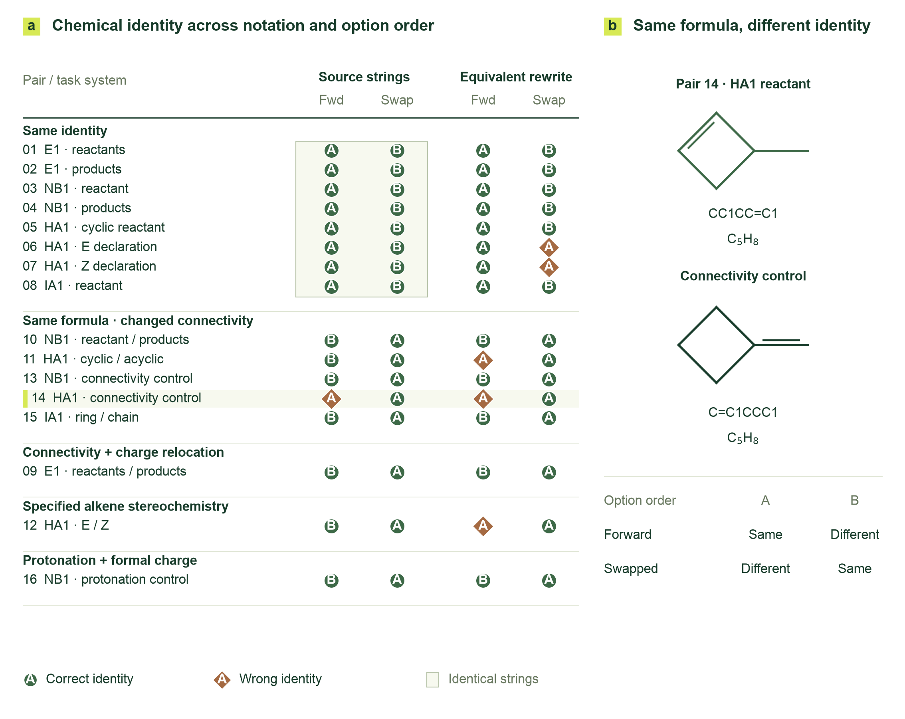
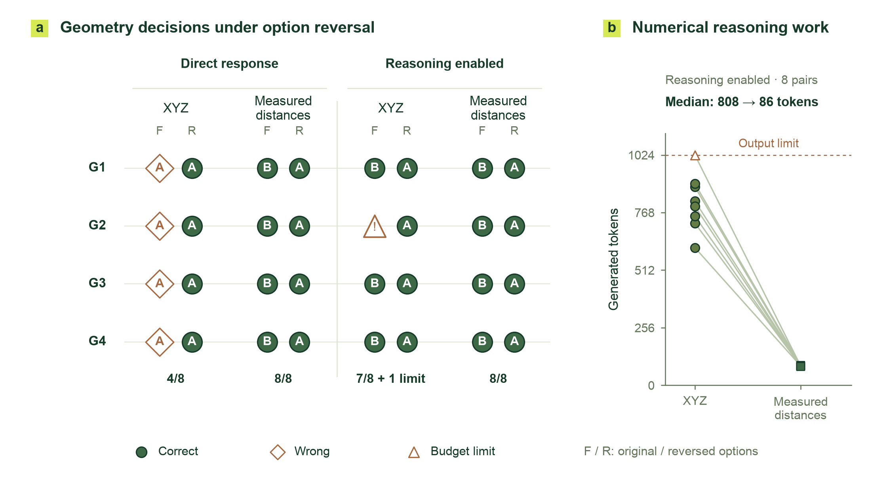
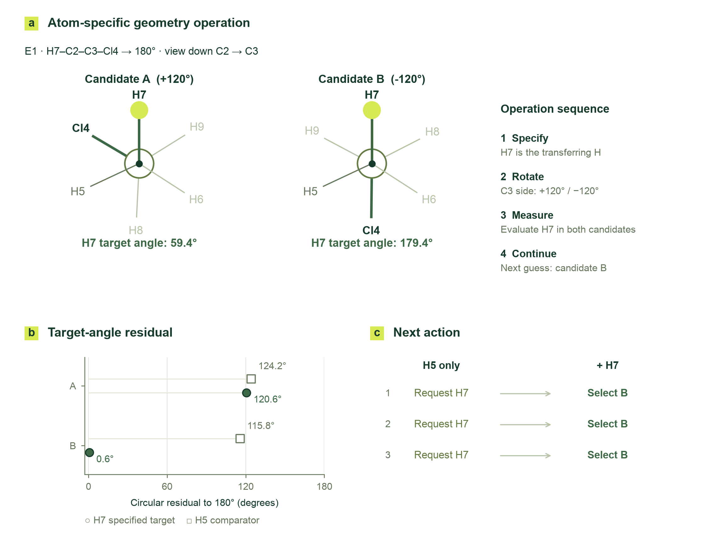
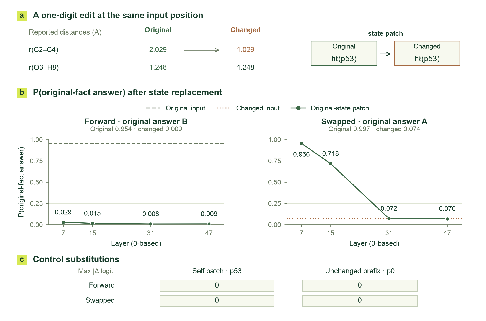
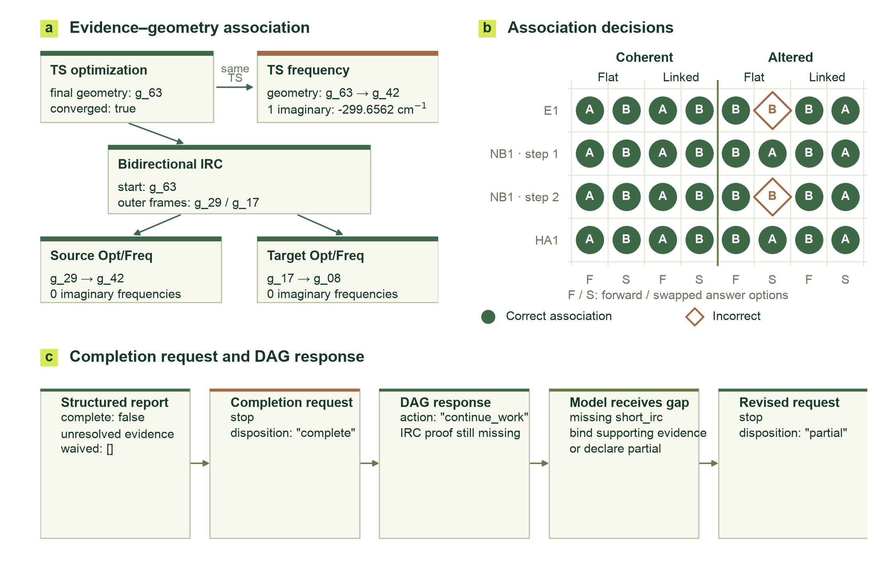

## 3 Results and Discussion

Cloudra is designed around two transitions in reaction-mechanism research: translating chemical intent into concrete geometric operations, and assembling local computational results into support for a scientific conclusion. Using autonomous research trajectories, paired local comparisons, and interventions on internal model states, this section examines how information contributes to these transitions and connects molecular representations, geometric operators, the evidence DAG, and diagnostic feedback.

### 3.1 Experimental systems and task coverage

The 50 chemical problems in CloudraBench cover elementary transformations, multistep processes, competing pathways, stereochemistry, and electronic-state-dependent judgments, categorized into 20 Easy, 10 Normal, 10 Hard, and 10 Impossible tasks, establishing a macroscopic benchmark for evaluating end-to-end autonomous exploration capabilities. Each task combines a chemical category with a research requirement. For example, an electrocyclic reaction may require identifying a reaction pathway or comparing the stereochemical outcomes of different directions of rotation. The same representations of reactants and products may also describe rearrangements between different configurations or questions of accessibility on a specified electronic surface. In a semantic analysis of task names, Diels–Alder reactions and cyclobutene ring openings each formed neighborhoods spanning difficulty levels, reflecting the intersecting distributions of chemical topics and research requirements.

To rigorously dissect the microscopic cognitive mechanisms, failure modes, and the two foundational transitions (intent-to-geometry and outputs-to-evidence) within large language models, this section focuses on 48 fully archived, end-to-end autonomous runs spanning all four difficulty tiers: four system configurations (Guided, Record, Standard, and Brief-errors) across four representative tasks, with three independent replicates each. The tasks comprise fluoride-mediated elimination of chloroethane (E1), thermal decarboxylation of malonic acid (NB1), stereoselective electrocyclic ring opening of 3-methylcyclobutene (HA1), and degenerate automerization of cyclobutadiene across rectangular and square configurations (IA1). These tasks probe reaction-center preorganization, multi-step continuity, competing stereochemical pathways, and surface-inaccessibility assertions, respectively. All runs proceeded in an unassisted autonomous mode; the archived conversational exchanges, tool invocations, central calculation ledgers (ComputeDB), and native quantum-chemical outputs (encompassing 6,087 relevant scientific tool records) provide the deterministic factual ground for the microscopic interpretability analysis and causal interventions presented below.

The archived runs used DeepSeek-v4-flash. Local diagnostics used Qwen3.8:27b with paired inputs constructed around source structures or evidence chains. These diagnostics varied molecular representation, option order, geometric information, evidence references, or reasoning mode, and recorded actual choices and generated token counts. The original trajectories show how problems arose during research; paired inputs reveal how specific information contributed to judgments; and internal-state interventions further trace the influence of measured facts on selection. The following analysis develops the two design themes through these three levels of evidence.

### 3.2 From chemical intent to reliable geometric operations

#### 3.2.1 Molecular identity provides a persistent reference for operations

A geometric modification first requires identifying the molecule, atoms, and reaction center to which it applies. A molecule can be represented by different SMILES traversals, while a molecular formula can describe different connectivities. To examine how the model handles these distinctions, we constructed 16 molecular-identity pairs covering identical identities, connectivity changes within the same molecular formula, changes in connectivity and charge location, double-bond stereochemistry, and protonation changes. Each pair was presented using the original strings or equivalent rewritings and with two answer orders, yielding 64 judgments.

The model answered 58 correctly. Equivalent rewriting changed the semantic judgment in 4 of 32 matched representation comparisons; reversing answer order changed the judgment in 6 of 32 matched option-order comparisons. All six of the latter cases involved repeated selection of the letter A. One C₅H₈ pair in Figure 5 illustrates this behavior directly: an endocyclic and an exocyclic double bond define different connectivities, yet the model answered A under all four conditions, although A meant “same” in one order and “different” in the other. This result locates representation sensitivity in judgments about the chemical objects themselves and indicates the need for stable identity references throughout a research process.

Cloudra assigns this role to molecular topology, atom mapping, and reaction centers. These references allow subsequent measurements, fragment movements, and endpoint comparisons to remain attached to the originally specified objects as the model moves between descriptions and configurations. Atom correspondence also connects product-endpoint alignment, path interpolation, and reaction-center monitoring, allowing local geometric operations to proceed with a consistent set of chemical identities.

Figure 5. Molecular-identity judgments under changes in molecular representation and option order. Each of the 16 molecular pairs has four input conditions. Circles and diamonds indicate correct and incorrect judgments, respectively; the letters retain the model's actual answers. Shaded regions denote identical-string conditions. The right panel shows the two C₅H₈ connectivities in pair 14 and the meanings of the answer options.

#### 3.2.2 Geometric measurements reduce repeated numerical reasoning

After identifying the research objects, the model must extract spatial relationships relevant to an operation from their coordinates. We selected four actual structures from the NB1 trajectories and asked the model to compare two specified interatomic distances. Each structure was presented with both answer orders and with either a complete XYZ geometry or program-measured distances. These two information conditions were further crossed with direct-answer and thinking modes, producing 32 native chat calls (Figure 6).

In direct-answer mode, all eight responses to XYZ inputs selected A, with four correct answers. Providing measured distances produced eight correct answers and preserved the semantic answer when option order was reversed. With thinking enabled, the XYZ condition produced seven correct answers; the remaining response reached the output limit of 1,024 generated tokens. Increasing the budget for that input alone yielded a correct answer within 1,353 generated tokens. All eight answers in the measured-distance condition were correct. Across the eight paired comparisons with thinking enabled, the median generated token counts were 807.5 for XYZ inputs and 86 for measured distances.

These results suggest that geometric judgment combines atom identification, numerical calculation, and relational comparison. Additional reasoning can perform these local calculations, while program measurements directly supply the relational quantities needed for the subsequent decision. Cloudra therefore allows the model to express objectives through bond lengths, bond angles, dihedral angles, and fragment relationships, and uses deterministic operators to change the coordinates. This division of work assigns repeated numerical operations to the program and makes the resulting changes directly inspectable, consistent with the allocation of responsibilities in program-aided language models.[15] Descriptions of steric crowding, reactant preorganization, and local fragment rotation build on this foundation to use spatial relationships in selecting and constructing candidate configurations.

Figure 6. Paired comparisons of coordinate inputs, program measurements, and reasoning modes. The left panel shows responses for four source structures under four conditions and two option orders; triangles indicate responses that reached the output budget. Each line in the right panel connects the actual generated token counts for the two information conditions for the same structure and option order with thinking enabled.

#### 3.2.3 Feedback must match the specified atoms and geometric objective

Deterministic execution must remain aligned with chemical intent. An actual E1 trajectory provides a complete example. The model sought to bring the dihedral angle defined by the transferring hydrogen H7, C2, C3, and leaving atom Cl4 close to 180°. It rotated the fragment on the C3 side about the C2–C3 axis by +120° and −120°, producing candidates A and B, and set the C3–Cl4 distance to 2.35 Å. The representative dihedral in the default structure report involved H5, whereas the current objective involved H7. The model then explicitly measured H7–C2–C3–Cl4 in both candidates, obtaining approximately 59.4° and 179.4°, and used candidate B in its next actual submission.

Figure 7 shows Newman projections along C2→C3 drawn directly from the saved candidate coordinates. Candidate B places the H7 target angle within 0.6° of 180°, compared with a residual of 120.6° for A. The corresponding residuals for the H5 comparison were 124.2° and 115.8° in A and B, respectively. These measurements reveal the object dependence of feedback: a reading acquires its chemical meaning through its correspondence to the currently specified atoms and operational objective.

Local comparisons using the same measurements further connect information to action. When only H5 measurements were provided, the model requested an additional H7 measurement under all three cyclic option permutations. Adding H7 measurements led it to select B under all three permutations. Two further paired tests of information sufficiency also shifted from requesting additional measurements to judging the information sufficient when the target quantity was added. Atom mapping, internal coordinates, fragment operations, and feedback can therefore be understood as one sequence of research actions: identify the target object, make the geometric change, measure the target quantity, and select the next candidate. Preorganization, rigid-body alignment, and path preparation use the same correspondence to carry reaction intent into subsequent exploration of the potential energy surface.

Figure 7. Alignment with the target and candidate selection in E1. Newman projections of candidates A and B are drawn using the projection direction of the original coordinates. H7 is the specified target atom. The lower panel compares the circular residuals of H7 and H5 relative to the target angle and shows the change from requesting a target measurement to selecting B across three local option permutations.

#### 3.2.4 Internal transfer of measured facts affects selection

To examine how the model uses supplied measurements, we performed activation replacement at a single token position in the same local quantized model.[16] One distance in the input was changed from 2.029 Å to 1.029 Å, while the other remained at 1.248 Å, reversing the correct comparison answer. We then transferred the residual-stream state at the numeric token position from the original input into the modified input at layers 7, 15, 31, and 47, and read the full-vocabulary probability assigned to the answer supported by the original fact.

The effect varied with layer and option order (Figure 8). With reversed options, the probability of A, the original-fact answer, increased from 0.074 for the modified input to 0.956 and 0.718 after replacement at layers 7 and 15, respectively. Replacements at layers 31 and 47 yielded 0.072 and 0.070. With the original option order, the probability of answer B changed from 0.009 to 0.029 and 0.015 after replacement at the first two tested layers, while the last two remained close to the modified-input baseline. Self-replacement controls and control replacements at an unchanged prefix position produced zero logit differences across the full vocabulary.

This internal intervention extends the analysis from supplying measurements to examining the causal mechanisms governing how measurement information shapes decisions: under reversed options, intermediate-layer state replacements dramatically flipped model predictions, demonstrating that localized numerical representations directly participate in downstream choices. Under the original option order, however, the patch produced only a minor shift, aligning closely with the behavioral positional bias identified in Section 3.2.1—when the target answer occupies the non-preferred option B, deep attention is readily captured by the shallow positional prior. This asymmetry establishes at the representation level that injecting ungrounded numerical facts into free-form text prompts is highly vulnerable to attentional attenuation and prior biases; only by coupling deterministic structural operators that explicitly bind geometric measurements, chemical entities, and operational semantics can a stable scientific decision loop be established. Cloudra's structured measurements thus serve not only as the outputs of geometric calculation, but as indispensable physical anchors for subsequent mechanistic reasoning.

Figure 8. Internal-state replacement for a single measured fact. The upper panel shows the changed distance value and residual-stream replacement. The middle panels plot the probability of the original-fact answer and the two input baselines under each option order. The lower panel shows self-replacement and prefix-replacement controls. Layer and token indices are zero-based.

### 3.3 From local computational results to evidence-supported scientific delivery

#### 3.3.1 The DAG preserves scientific support relationships among results

Once geometric objects enter computation, optimized structures, energies, frequencies, and paths must be assembled into support for the same reaction step. The local validity and attribution of each result jointly determine this support chain: frequencies must correspond to the declared saddle point, the IRC must start from that saddle point, and optimizations and frequencies for the final frames on both sides must correspond to the respective endpoints. The DAG records these relationships on species and elementary steps, providing a persistent research index as results accumulate. Execution state, numerical convergence, and scientific support are recorded separately, allowing subsequent work to wait for a calculation, revise and rerun it, or continue assembling evidence.

We extracted four source evidence chains from the archive and constructed versions that preserved the links or changed a single reference. Crossing these with flat and linked representations and two answer orders yielded 32 inputs. The altered references concerned the frequency geometry, IRC starting geometry, endpoint-optimization input, or target species; local termination, convergence, energy, and frequency values were held constant. Figure 9a illustrates the E1 case: changing the frequency geometry reference from the saddle point to an existing endpoint changes how that frequency result supports the current step.

All 16 judgments with linked representations were correct, compared with 14 of 16 with flat representations. Both errors occurred when a reference had been changed and the options reversed, in E1 and the second NB1 step. In subsequent native follow-up calls on two selected source chains, enabling thinking yielded correct judgments for all 16 judgments of the evidence relationships, including the two previously incorrect cases. This result suggests that explicit links reduce the model's work in locating and assembling computational relationships, consistent with observations that graph encoding affects relational reasoning in language models.[17] In Cloudra, this representation is further bound to actual computational artifacts, allowing scientific facts to accumulate continuously for the same species, step, and attempt.

#### 3.3.2 Diagnostics turn evidence gaps into concrete research actions

Broken evidence chains must be translated into targeted, physically grounded feedback to effectively drive autonomous corrective actions. When confronted with voluminous unstructured text outputs from quantum-chemical calculations, large language models readily overlook critical geometric and physical anomalies within their attention context. In contrast, structured diagnostic operators eliminate textual redundancy by isolating specific failure modes (e.g., steric clash atom pairs, imaginary-mode misalignments, or trajectory endpoint dislocations), providing concrete targets for subsequent local iterations.

Autonomous exploration trajectories highlight the decisive impact of diagnostic granularity on recovery. In a Brief-errors HA1 trial, where specific diagnostic feedback on IRC-endpoint linkage was ablated in favor of compact error codes, the Computational Agent succumbed to blind retries—mechanically substituting source-minimum references while leaving the underlying geometric disconnection unresolved. Conversely, in a Guided NB1 trial, the underlying verification detected zero imaginary frequencies and categorized the failure as a normal-mode error; the Coordinator immediately formulated a targeted retry plan, directing the Computational Agent to revise transition-state guess parameters and optimization constraints, which were faithfully incorporated into the rescheduled calculation. This ablation demonstrates that recovery in long-horizon mechanism elucidation depends not merely on detecting setbacks, but on bridging evidence defects directly to the specific chemical entities and computational parameters requiring revision.[18]

This mechanism substantiates the empirical efficacy of Cloudra's multi-agent division of responsibilities: Computational Agents iteratively refine specific geometries and paths using localized feedback, the Coordinator oversees branching hypotheses and route selection across the reaction network, and the Supervisor audits cumulative support against immutable task rubrics. Supported by central asynchronous execution and durable ledgers, each role maintains continuous context around shared chemical entities, preventing communicative drift across extended exploration horizons.

#### 3.3.3 Outstanding requirements must remain part of completion decisions

The final stage of scientific delivery requires a global determination: whether the accumulated computational artifacts genuinely satisfy rigorous physicochemical acceptance contracts. An autonomous IA1 trajectory reveals an inherent vulnerability of large language models during scientific research: premature completion hallucination. In this case, the reaction step lacked mandatory bidirectional short_irc verification, with an empty waiver list; however, because the Supervisor had previously offered affirmative comments on intermediate optimization convergence, the model suffered cognitive drift and attempted to declare the exploration complete. In an unconstrained or purely conversational architecture, such unsupported mechanistic claims would escape scrutiny and produce false deliverables.

Here, the delivery graph's deterministic physical gate intervened decisively. The harness rejected the premature completion request and injected the unresolved short_irc requirement as a hard constraint back into the context. Confronted with this unyielding physical reality, the model immediately rectified its claim in the subsequent submission, correctly downgrading its status to partial completion (Figure 9c).

When physical state is explicitly recorded in an immutable ledger, the model reliably anchors its reasoning to this authoritative source. Across 12 paired trials evaluating IA1 under both minimal summary and extended 12-message history contexts, the model achieved 100% accuracy in identifying unsatisfied scientific requirements across all state queries and reversed option orders. The delivery DAG thus provides an immutable coordinate system for subsequent reasoning: demarcating verified entities, pinpointing existing deficits, and determining whether to pursue additional calculations or submit partial deliverables reflecting physical reality.

The two design themes converge here. On the geometric reasoning side, the architecture binds chemical intent to explicit atom indices, local topologies, and three-dimensional operators, freeing the language model from prone numerical arithmetic to focus on hypothesis evolution. On the scientific evidence side, the delivery DAG and physical validation gates retain strict authority over claim acceptance, anchoring every conclusion to genuine quantum-chemical artifacts. Cloudra's empirical findings demonstrate that only by providing deterministic operational handles for intent and enforcing immutable physical contracts for delivery can the generative capabilities of large language models be transformed into rigorous, reproducible, and autonomous scientific discovery.

Figure 9. Evidence links and completion decisions. a, A changed frequency-geometry reference in the E1 source chain. b, The 32 responses for four source chains under crossed conditions of linkage status, representation, and option order. c, The behavioral sequence in the original IA1 trajectory, from the report of outstanding requirements through a completion request and DAG feedback to a partial-completion request.

### References for this section

[15] Gao, L.; Madaan, A.; Zhou, S.; et al. PAL: Program-aided Language Models. Proceedings of the 40th International Conference on Machine Learning 2023, 202, 10764–10799. https://proceedings.mlr.press/v202/gao23f.html

[16] Zhang, F.; Nanda, N. Towards Best Practices of Activation Patching in Language Models: Metrics and Methods. International Conference on Learning Representations 2024. https://proceedings.iclr.cc/paper_files/paper/2024/hash/06a52a54c8ee03cd86771136bc91eb1f-Abstract-Conference.html

[17] Fatemi, B.; Perozzi, B.; Halcrow, J. Talk like a Graph: Encoding Graphs for Large Language Models. International Conference on Learning Representations 2024. https://research.google/pubs/talk-like-a-graph-encoding-graphs-for-large-language-models/

[18] Gou, Z.; Shao, Z.; Gong, Y.; et al. CRITIC: Large Language Models Can Self-Correct with Tool-Interactive Critiquing. International Conference on Learning Representations 2024. https://arxiv.org/abs/2305.11738
